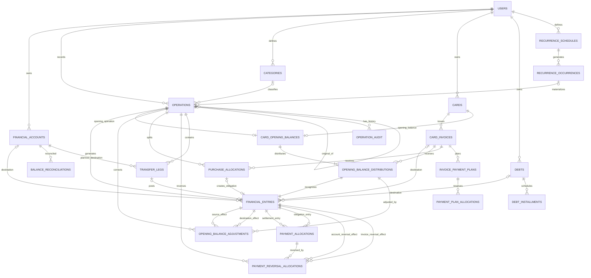

# 07 — Modelo Entidade-Relacionamento (ER) do Orbe

**Estado: proposta conceptual consolidada para aprovação documental.** O modelo incorpora as regras financeiras e os fluxos refinados de cartões, faturas, compras parceladas, pagamentos, planos vencidos, transferências e reembolsos. Ainda não é o esquema físico definitivo, não fecha todas as decisões de produto e não autoriza a criação de migrations.

## 1. Objetivo e princípio de desenho

O modelo deve suportar uma única realidade financeira, consultada por páginas com objetivos diferentes. O Orbe não terá uma base de dados para o Dashboard, outra para Movimentos e outra para a Rota Financeira.

O desenho assenta em três conceitos distintos:

1. **Operação:** acontecimento de negócio reconhecido pelo utilizador (despesa, receita, compra com cartão, pagamento, transferência, reversão, entre outros).
2. **Lançamento financeiro:** efeito efetivo de uma operação sobre um destino financeiro (conta, fatura ou dívida).
3. **Projeção:** cálculo temporal que combina saldos reais com acontecimentos futuros ainda não confirmados. É um resultado calculado, não um lançamento efetivo.

Esta separação preserva a regra de que só lançamentos válidos e realizados alteram saldos efetivos. Um lançamento dirigido a uma fatura pode reconhecer uma obrigação efetiva sem representar saída de dinheiro de uma conta. Pendentes e projeções de fluxo de caixa nunca são registados como saídas efetivas de conta.

## 2. Modelo conceptual ER

O diagrama seguinte representa as entidades centrais e as relações propostas. A cardinalidade exata e algumas constraints adicionais serão fechadas no modelo físico.

**Leitura do diagrama:**
- Uma operação pode ainda não ter lançamentos (pendente) ou gerar um ou vários lançamentos quando confirmada.
- Cada lançamento aponta para exatamente um destino: conta, fatura ou dívida. É a decisão ARC-001 já aprovada.
- Uma fatura/período pertence a um cartão. Pode estar `PLANNED`, `OPEN` ou `CLOSED`; o estado do ciclo é distinto do valor em dívida.
- Uma compra parcelada cria alocações e lançamentos de obrigação na confirmação, mesmo para períodos `PLANNED`. A abertura do ciclo não cria novos lançamentos.
- Um pagamento de fatura gera saída na conta e redução na fatura; `payment_allocations` identifica as obrigações específicas liquidadas.
- Planos de pagamento são projeções, não lançamentos; a reserva explícita e a liquidação residual não podem duplicar a mesma obrigação.
- Uma dívida pode ter várias prestações planeadas. As prestações não são novas dívidas.
- Uma programação gera ocorrências individualizadas. Uma ocorrência pode originar, no máximo, uma operação.
- Uma transferência tem duas pernas (saída e entrada), com data e estado independentes. Cada perna gera o respetivo lançamento quando realizada.
- Uma operação de correção/reversão/reembolso referencia a operação de origem; a original permanece preservada.
- Uma conferência de saldo pertence a uma conta, mas não gera lançamentos.

## 3. Entidades e responsabilidades

### 3.1 Núcleo financeiro

| Entidade | Responsabilidade | Campos conceptuais principais |
|---|---|---|
| `users` | Utilizador e preferências centrais | id, moeda principal |
| `financial_accounts` | Contas bancárias, dinheiro físico e carteiras digitais | id, user_id, tipo, nome, instituição/descrição, estado |
| `categories` | Classificação de receitas e despesas | id, user_id, nome, natureza, estado |
| `operations` | Evento de negócio visível e manipulável pelo utilizador | id, user_id, category_id, tipo, descrição, valor, estado, data efetiva, data prevista, operação de origem |
| `financial_entries` | Efeitos financeiros confirmados; fonte de verdade dos saldos/obrigações | id, operation_id, destino ARC-001, valor, efeito sobre o destino, data efetiva, purchase_allocation_id quando for obrigação de compra parcelada |
| `operation_audit` | Histórico técnico/funcional de alterações relevantes | id, operation_id, ator, alteração, motivo, data |

**Operação e lançamento não são sinónimos.** A operação conserva a identidade do evento. Os lançamentos registam os efeitos sobre os destinos. Uma operação de pagamento pode, por exemplo, produzir um lançamento na conta e outro na fatura ou dívida.

O valor da operação não deve ser calculado somando indiscriminadamente os valores dos seus lançamentos: em pagamentos e transferências, os vários lançamentos representam efeitos associados do mesmo montante. As métricas de receitas/despesas contam a operação uma vez, segundo a sua natureza.

### 3.2 Destinos dos lançamentos — ARC-001

A tabela `financial_entries` terá referências específicas:

- `account_id` — efeito numa conta;
- `invoice_id` — efeito numa fatura de cartão;
- `debt_id` — efeito numa dívida/obrigação.

As três referências serão opcionais individualmente, mas **exatamente uma deve estar preenchida por lançamento**. Cada uma terá uma FK real. Uma `CHECK CONSTRAINT` deve garantir o destino único. Não utilizar `destination_type + destination_id` para estes destinos.

O valor do lançamento é positivo e o campo conceptual `effect` indica se aumenta ou reduz o saldo relevante do destino:
- Conta: aumentar ou reduzir dinheiro disponível.
- Fatura/dívida: aumentar ou reduzir o valor em aberto.

A semântica do efeito depende do tipo de destino. O campo não deve ser confundido com a classificação económica da operação (receita, despesa, transferência ou liquidação).

Referências compostas ou validação transacional deverão impedir que uma operação de um utilizador aponte para conta, fatura ou dívida de outro utilizador.

### 3.3 Cartões, ciclos, compras parceladas e faturas

| Entidade | Responsabilidade | Campos conceptuais principais |
|---|---|---|
| `cards` | Cartão de crédito e condições | id, user_id, nome, limite, condições de fecho/vencimento |
| `card_invoices` | Período/fatura de um cartão | id, card_id, período, data de fecho, data de vencimento, estado do ciclo |
| `purchase_allocations` | Distribuição de uma compra pelos períodos de faturação | id, purchase_operation_id, invoice_id, amount |
| `invoice_payment_plans` | Intenção de pagamento e data prevista | id, invoice_id, operation_id, amount, planned_date, state |
| `payment_plan_allocations` | Parcela da obrigação reservada por um plano | id, payment_plan_id, obligation_entry_id, amount |
| `payment_allocations` | Associação entre redução de fatura e obrigações liquidadas | id, payment_operation_id, settlement_entry_id, obligation_entry_id, amount |
| `payment_reversal_allocations` | Rastreabilidade da reversão de uma alocação de pagamento | id, reversal_operation_id, original_payment_allocation_id, account_reversal_entry_id, invoice_reversal_entry_id, amount |

#### Ciclos e faturas

`card_invoices` representa o período interno de faturação e a sua apresentação operacional. Estados conceptuais do ciclo:
- `PLANNED`: período futuro identificado, ainda não aberto na interface;
- `OPEN`: ciclo operacional atual;
- `CLOSED`: ciclo encerrado.

O estado do ciclo não é o estado da obrigação. Um ciclo `CLOSED` pode continuar com valor em dívida; podem existir várias faturas anteriores com obrigação pendente. No máximo uma fatura por cartão pode estar em `OPEN`.

No MySQL 8.4, a unicidade de `OPEN` deve ser protegida por uma coluna gerada nullable (por exemplo, chave igual a `card_id` apenas quando o ciclo está `OPEN`, caso contrário `NULL`) com índice `UNIQUE`. A abertura deve ocorrer em transação, bloqueando a linha do cartão com `SELECT ... FOR UPDATE`; o índice único é a proteção final. Também deve existir unicidade de `(card_id, billing_period)`.

#### Compra com cartão e alocações

A compra com cartão é uma operação económica única. Na confirmação:
1. reconhecer a despesa uma única vez pelo valor total;
2. criar as `purchase_allocations` que distribuem o valor pelos ciclos;
3. criar um lançamento de obrigação por alocação, com destino à fatura/período correspondente, mesmo quando o ciclo está `PLANNED`;
4. não criar saída de conta bancária.

A abertura posterior do período apenas altera estado e apresentação. Não cria lançamentos adicionais. Para uma compra de 1.200 € em quatro parcelas, a despesa é 1.200 € e as quatro obrigações são 300 € cada; não são quatro operações de despesa.

Relação proposta: `financial_entries.purchase_allocation_id` referencia `purchase_allocations.id`, com `UNIQUE` para garantir no máximo um lançamento de obrigação por alocação. A soma das alocações deve igualar o valor da compra e exige validação transacional/domínio. O lançamento continua a ter `invoice_id` como único destino ARC-001; `purchase_allocation_id` é referência de rastreabilidade, não um segundo destino.

#### Pagamento e alocação às obrigações

Um pagamento confirmado pode abranger uma ou várias faturas. Gera uma única saída total na conta e um lançamento de redução por cada fatura abrangida. `payment_allocations` liga cada lançamento de redução (`settlement_entry_id`) aos lançamentos originais de obrigação (`obligation_entry_id`) que liquida. Cada par de redução/obrigação pertence à mesma fatura; a operação de pagamento pode abranger faturas diferentes.

Invariantes:
- todos os registos envolvidos pertencem ao mesmo utilizador;
- cada par `settlement_entry`/`obligation_entry` pertence à mesma fatura;
- todos os lançamentos de redução pertencem à mesma operação de pagamento;
- a soma das reduções por fatura corresponde ao valor da saída total na conta;
- a soma das alocações corresponde a cada redução de fatura;
- a soma alocada a uma obrigação não ultrapassa o seu saldo restante;
- uma alocação não é lançamento e não altera saldos diretamente;
- a saída, todas as reduções e todas as alocações são confirmadas na mesma transação;
- validações multi-linha exigem bloqueio/transação; não podem depender apenas de `CHECK` de linha;
- repetição do pedido de pagamento é idempotente.

#### Reversão de pagamentos

`payment_allocations` regista apenas a liquidação original. A reversão é rastreada por uma relação própria, `payment_reversal_allocations`, que associa a operação de reversão à alocação original e aos efeitos financeiros compensatórios.

Cada registo identifica a `payment_allocation` original, o lançamento de entrada na conta, o lançamento de aumento da obrigação na mesma fatura e o montante revertido. A soma das reversões associadas a uma alocação nunca pode exceder o valor original dessa alocação. Reversões parciais são permitidas; o saldo ainda reversível é calculado considerando todas as reversões anteriores.

A operação de reversão, os efeitos na conta e nas faturas e as relações de rastreabilidade são atómicos. A reversão não apaga nem altera a liquidação original. Uma reversão pode abranger várias alocações originais, mantendo uma única operação de reversão e uma única entrada total na conta, com aumentos por fatura e relações específicas por alocação compensada.

#### Planos de pagamento e projeção

`invoice_payment_plans` e `payment_plan_allocations` representam intenção e reserva para projeção, não efeitos realizados. Os lançamentos efetivos só surgem quando o pagamento é confirmado.

- A projeção explícita cobre apenas a parte da obrigação reservada pelo plano.
- A liquidação residual automática cobre apenas a obrigação não reservada.
- Um plano não confirmado na data prevista passa a vencido; deixa de ser uma saída futura na data passada, mas a obrigação permanece em aberto/vencida.
- O valor vencido não é automaticamente reagendado para uma nova data sem regra de produto aprovada.
- Cancelar ou alterar um plano liberta/atualiza a reserva de forma auditada.
- A confirmação substitui a projeção correspondente por efeitos efetivos, sem duplicação.
- Para uma mesma obrigação, pagamentos realizados, reservas ativas e residual projetado não podem exceder o saldo em aberto, salvo política explícita de crédito aprovada.

#### Saldo inicial do cartão e distribuição por faturas

O saldo já utilizado antes da entrada do utilizador no Orbe é registado por uma operação própria, de natureza `CARD_OPENING_BALANCE`. Esta operação não é compra, despesa, receita nem pagamento e não gera saída de conta. Cada efeito financeiro que reconhece o saldo inicial aponta diretamente para uma fatura através de `invoice_id`, preservando ARC-001.

Na criação do cartão:
- saldo inicial igual a zero: não é necessária operação de saldo inicial;
- saldo inicial positivo: é obrigatória a distribuição integral por faturas/ciclos;
- a soma das distribuições iniciais tem de ser exatamente igual ao saldo informado;
- não existe parcela por distribuir;
- os ciclos futuros podem estar em `PLANNED`, sem aparecerem como várias faturas abertas na interface.

Entidades conceptuais:
| Entidade | Responsabilidade | Campos conceptuais principais |
|---|---|---|
| `card_opening_balances` | Extensão 1:1 da operação original, associando-a a um cartão | id, card_id, operation_id, declared_amount |
| `opening_balance_distributions` | Distribuição histórica inicial, imutável, por fatura | id, opening_balance_id, invoice_id, amount, obligation_entry_id |
| `opening_balance_adjustments` | Correção/redistribuição posterior, ligada à distribuição e à operação corretiva | id, source_distribution_id, correction_operation_id, adjustment_type, source_entry_id, destination_invoice_id, source_reduction_entry_id, destination_increase_entry_id, reverses_adjustment_id quando aplicável, amount |

Cardinalidades e limites:
- Um cartão tem zero ou uma operação original de saldo inicial; a extensão `card_opening_balances` é única por cartão e por operação.
- Uma operação original pertence a um único cartão e pode originar uma ou várias distribuições.
- Cada distribuição inicial pertence a uma única operação original e a uma fatura; gera um lançamento de obrigação com destino à mesma fatura.
- Uma operação corretiva pode ajustar várias distribuições; cada ajuste identifica a obrigação de origem, a fatura de destino e os dois lançamentos corretivos.
- Uma correção nunca constitui uma segunda operação original.
- `opening_balance_distributions` preserva a distribuição histórica inicial. Não se atualiza silenciosamente o seu valor ou `invoice_id`.

A distribuição histórica inicial mantém-se igual ao valor reconhecido, mesmo depois de pagamentos. Correções/redistribuições são registadas separadamente por efeitos: redução na fatura de origem e aumento na fatura de destino. A obrigação em aberto é sempre reconstruída a partir de `financial_entries` válidos; as tabelas de distribuição servem para proveniência e rastreabilidade, não para manter um saldo paralelo.

Para cada distribuição, a posição vigente considera o valor original, os ajustes de entrada/saída e as liquidações/reversões associadas aos lançamentos da sua linhagem. O montante redistribuível é apenas a parcela ainda não liquidada nem comprometida por correções anteriores. Exemplo: distribuição de 1.000 €, correção de 300 € para outra fatura e pagamento líquido de 400 € deixam 300 € disponíveis para nova redistribuição. O cálculo considera todos os efeitos acumulados, não apenas o valor da linha original.

A reversão de uma distribuição ou correção cria novos efeitos contrários associados ao evento original. O registo corretivo identifica o tipo de ajuste e, quando reverte uma correção anterior, referencia-a explicitamente por `reverses_adjustment_id`; quando reverte a distribuição inicial, referencia a distribuição original. O valor revertido não pode exceder o montante ainda reversível, considerando correções posteriores e pagamentos líquidos. Valores já liquidados não podem ser redistribuídos nem revertidos como se continuassem disponíveis.

A criação do saldo inicial, as distribuições e os respetivos lançamentos são atómicos e idempotentes. A repetição do mesmo comando não pode criar uma segunda operação original, duplicar distribuições ou duplicar lançamentos.

### 3.4 Dívidas e prestações

| Entidade | Responsabilidade | Campos conceptuais principais |
|---|---|---|
| `debts` | Obrigação financeira | id, user_id, nome, tipo, data de origem, condições |
| `debt_installments` | Agenda de prestações da obrigação | id, debt_id, número, data prevista, valor planeado |

Os pagamentos são operações próprias, com lançamentos na conta de origem e na dívida. Podem ser parciais e partir de contas diferentes. O saldo em aberto é derivado dos efeitos válidos dirigidos à dívida.

As prestações representam a agenda/afetação da obrigação, não uma segunda dívida. A associação explícita de cada pagamento a uma ou várias prestações ainda deve ser fechada nas regras de detalhe de Dívidas; não se deve presumir uma regra FIFO nem criar uma tabela de afetação sem essa decisão.

### 3.5 Transferências

Uma operação de transferência contém exatamente duas pernas conceptuais: uma saída (`OUT`) e uma entrada (`IN`). Cada perna conserva a sua própria data prevista/efetiva e estado `PENDING`, `REALIZED` ou `CANCELLED`. Quando realizada, gera um lançamento com destino à respetiva conta. O valor e a associação entre as duas pernas são coerentes.

A interface apresenta uma única operação de transferência, não duas operações soltas. Os dois lançamentos existem para atualizar corretamente os saldos das contas. No agregado de todas as contas, uma transferência concluída não altera o património líquido.

O estado global é derivado das duas pernas: pendente/pendente = planeada; realizada/pendente ou pendente/realizada = parcial; realizada/realizada = concluída; cancelada/cancelada = cancelada. Combinações de uma perna realizada com a outra cancelada são exceções de liquidação e exigem ação corretiva explícita; não se pode apagar ou cancelar o efeito já realizado.

A diferença entre saídas realizadas e entradas realizadas deve ser apresentada como desequilíbrio de liquidação (saída não correspondida ou entrada não correspondida), não como saldo de caixa adicional nem como terceiro lançamento. Uma entrada realizada antes da saída aumenta efetivamente a conta de destino, mas permanece identificada como perna não correspondida.

No modelo físico será necessário impor exatamente uma perna `OUT` e uma `IN`, valor coerente, unicidade por operação/direção e correspondência entre perna, conta e lançamento. A validação exige constraints e transação; a mera cardinalidade do diagrama não a garante.

### 3.6 Recorrências e classificação

| Entidade | Responsabilidade |
|---|---|
| `recurrence_schedules` | Regra de repetição e configuração da programação |
| `recurrence_occurrences` | Ocorrências individualizadas, com data/valor/estado próprios e chave de unicidade |

Cada ocorrência pode materializar uma operação. Quando isso acontece, a projeção deve utilizar a operação gerada, e não contar também a ocorrência como outro evento. A unicidade da ocorrência e a geração idempotente impedem duplicações.

A classificação para estimativas da Rota tem precedência: operação → ocorrência → programação → categoria → `UNCLASSIFIED`. A classificação resolvida deve ficar materializada na operação para preservar histórico. `EXCLUDED` significa excluída apenas da estimativa variável; `UNCLASSIFIED` não pode ser silenciosamente tratada como zero ou como variável. A categoria fornece o padrão; programação, ocorrência e operação podem substituí-lo nessa ordem de especificidade.

Alterações a uma ocorrência ou à ocorrência selecionada e seguintes respeitam as regras aprovadas; ocorrências passadas/realizadas não são reescritas.

### 3.7 Conferência de saldos

`balance_reconciliations` guarda a comparação entre:
- saldo calculado da conta na data da conferência;
- saldo real informado pelo utilizador;
- diferença e data da conferência.

É um registo de comparação, não um movimento. Não cria `financial_entries`, não altera o saldo calculado e não corrige diferenças artificialmente.

## 4. Regras de integridade do modelo

1. Um lançamento pertence a uma única operação.
2. Um lançamento tem exatamente um destino, protegido por FKs específicas e `CHECK`.
3. Só lançamentos válidos e realizados entram no cálculo de saldos efetivos.
4. Lançamentos confirmados não são apagados ou alterados silenciosamente.
5. Uma reversão é uma nova operação com lançamentos de efeito contrário, ligada à origem.
6. Um reembolso mantém ligação à operação de origem.
7. Uma operação pendente pode existir sem lançamentos efetivos.
8. Uma operação cancelada mantém histórico e não afeta saldos nem projeções.
9. Pagamentos parciais são operações individuais; o montante em aberto resulta dos efeitos registados.
10. A mesma operação não pode surgir repetida numa lista devido a ter vários lançamentos.
11. Transferências mantêm duas pernas associadas; cada lançamento afeta apenas a sua conta/destino.
12. Ocorrências recorrentes são únicas e a materialização em operação é idempotente.
13. Conferências de saldo não participam no livro de lançamentos.
14. Dados derivados (saldo de conta, valor em aberto, disponível do cartão e totais) podem ser guardados como cache, mas têm de ser reconstruíveis a partir das fontes de verdade.
15. Cada alocação de compra cria no máximo um lançamento de obrigação; abrir um ciclo não cria novos lançamentos.
16. Pagamento de fatura liga o lançamento de redução às obrigações liquidadas por alocações explícitas.
17. Planos de pagamento e reservas de projeção não são lançamentos efetivos.
18. A soma de pagamentos alocados a uma obrigação não pode exceder o seu saldo restante.
19. Ciclos `PLANNED`, `OPEN` e `CLOSED` são estados operacionais; não representam diretamente o estado de liquidação da obrigação.
20. Transferências têm uma perna `OUT` e uma `IN`; estados globais são derivados e não apagam efeitos realizados.
21. Um cartão tem zero ou uma operação original de saldo inicial; o saldo inicial positivo é integralmente distribuído por faturas.
22. A distribuição histórica inicial é imutável; correções e redistribuições são novos efeitos rastreáveis.
23. A obrigação em aberto e o saldo utilizado são derivados de `financial_entries`, nunca das tabelas de distribuição isoladamente.
24. Uma redistribuição só pode consumir obrigação ainda não liquidada e não comprometida por correções anteriores.
25. Reversões de pagamento referenciam as alocações originais e não podem exceder o valor ainda não revertido.
26. Um pagamento multi-fatura tem uma saída total, reduções por fatura e alocações por par de lançamentos da mesma fatura; todos os efeitos são atómicos.
27. Criação do saldo inicial, correções, redistribuições e reversões são idempotentes.

## 5. A mesma base de dados, três objetivos de página diferentes

Esta é a distinção funcional mais importante para o desenho do Orbe:

| Página | Objetivo | Granularidade apresentada | Fonte primária | Pendentes/projeções |
|---|---|---|---|---|
| Dashboard | Resumo rápido da posição atual e atividade do mês | KPIs e operações recentes | Contas, lançamentos e operações | Sem projeções; o saldo é sempre atual |
| Movimentos | Consultar e gerir o registo operacional | Uma linha por operação | Operações, com lançamentos relacionados | Mostra estados Realizado, Pendente e Cancelado conforme filtros |
| Rota Financeira | Compreender a evolução diária e simular o futuro | Uma linha por dia, com saldo acumulado | Lançamentos realizados + fontes de eventos futuros | Inclui projeção; não transforma pendentes em realizados |

### 5.1 Dashboard — fotografia atual, não simulação

- **Saldo total:** soma dos saldos efetivos de todas as contas, calculados a partir dos lançamentos realizados com destino a conta. O seletor de mês não altera este valor.
- **Receitas e despesas do mês:** a consulta deve agrupar operações realizadas pela natureza económica, contando cada operação uma vez. Transferências e pagamentos de faturas/dívidas não são novas receitas/despesas. Uma compra com cartão conta como despesa na data da compra.
- **Últimos movimentos:** consulta operações, não linhas de lançamento. Assim, uma transferência ou um pagamento com dois lançamentos aparece uma só vez.
- **Seletor mensal:** filtra KPIs e atividade histórica; não muda o saldo atual.
- Não calcular saldo futuro nem incluir previsões nos KPIs do Dashboard.

A lista de atividade recente pode apresentar o estado da operação; o âmbito exato de inclusão de pendentes nessa lista deve respeitar o desenho final do componente, sem os incorporar em saldos efetivos.

### 5.2 Movimentos — registo de operações

- A entidade raiz da lista é `operations`, não `financial_entries`.
- Cada operação aparece uma vez, mesmo que gere vários lançamentos.
- Filtros de conta devem testar a existência de lançamento para essa conta, sem multiplicar linhas da operação.
- Filtros de categoria, tipo, data e estado aplicam-se à operação.
- As vistas de detalhe podem consultar todos os lançamentos e entidades relacionados.
- A aba Programações consulta `recurrence_schedules` e ocorrências; não mistura a regra recorrente com cada operação já materializada.
- Pendentes são visíveis e geríveis, mas não alteram o saldo efetivo.

### 5.3 Rota Financeira — simulação diária sobre o motor central

A Rota não é outra lista de operações nem outro livro contabilístico. É uma consulta de fluxo de caixa por dia, com saldo acumulado.

**Componente realizado:**
- Parte dos saldos reais no início do período.
- Usa os lançamentos efetivos dirigidos a contas, agrupados pela data efetiva.
- O saldo de cada dia é o saldo anterior mais entradas menos saídas efetivas.
- Dias sem movimentos mantêm o saldo acumulado.
- Transferências usam os efeitos de cada perna na respetiva conta/data; no total agregado, as duas pernas concluídas compensam-se.

**Componente projetado:**
- Considera operações pendentes com data/valor previstos.
- Considera ocorrências futuras de recorrências ainda não materializadas.
- Considera prestações futuras e faturas por pagar com vencimento conhecido, de acordo com as regras de projeção que vierem a ser fechadas.
- Não grava estes valores como lançamentos reais.
- A confirmação de um evento cria os lançamentos efetivos e retira o respetivo valor da projeção, sem duplicação.

**Distinção crítica para cartões:**
- A compra é reconhecida como despesa na data da compra e aparece em Movimentos/Relatórios.
- A compra não é saída imediata de uma conta bancária.
- A saída de dinheiro é projetada na data prevista de pagamento da fatura e só passa a efetiva quando o pagamento é confirmado.
- Se já existir um pagamento pendente explícito para a fatura, a Rota não pode somar também uma segunda saída automática pela mesma obrigação.
- Planos não confirmados na data prevista passam a vencidos; deixam de ser eventos futuros na data passada, mas a obrigação continua vencida e visível.
- A liquidação residual automática cobre apenas o saldo não reservado por planos explícitos.
- Sem regra aprovada de débito automático/reagendamento, a Rota não inventa uma nova data futura para obrigações vencidas.

**Distinção crítica para dívidas:**
- A obrigação e a agenda de prestações permitem identificar compromissos futuros.
- Um pagamento pendente já associado à prestação deve substituir, e não duplicar, a projeção dessa prestação.
- A confirmação do pagamento cria efeitos na conta e na dívida; apenas o efeito da conta entra no fluxo de caixa.

A Rota produz uma grelha diária e um saldo projetado no fim do mês. A camada de projeção deve ser um serviço/consulta derivada, não uma segunda fonte de verdade nem uma tabela de lançamentos projetados.

### 5.4 Outras páginas — fontes de leitura

| Página | Leitura principal |
|---|---|
| Contas | Contas e lançamentos realizados por conta; conferências em tabela própria |
| Cartões | Cartões, faturas e efeitos de compra/pagamento nas faturas; utilização/disponível derivados |
| Dívidas | Dívidas, lançamentos dirigidos à dívida e agenda de prestações; valor em aberto derivado |
| Relatórios | Operações realizadas e respetivas classificações; sem projeções |
| Configurações | Preferências do utilizador, moeda e categorias; não altera diretamente operações financeiras |

## 6. Consultas e cálculos que não devem ser confundidos

### Saldo de conta
Calculado apenas por lançamentos realizados cujo destino é a conta em causa. Uma conferência de saldo não é adicionada ao cálculo.

### Saldo total no Dashboard
Soma dos saldos efetivos das contas incluídas. Não é o saldo no fim do mês selecionado nem uma projeção.

### KPI de despesas
Agrega operações realizadas classificadas como despesa. Não soma todos os lançamentos associados, porque pagamentos e transferências podem gerar mais de um efeito para a mesma operação.

### Valor em aberto de fatura/dívida
Calculado pelos efeitos de aumento e redução dirigidos à fatura/dívida. Pagamentos parciais reduzem o valor em aberto sem eliminar a obrigação.

### Saldo da Rota
É uma série temporal: saldo efetivo de partida + efeitos reais por data + eventos futuros simulados. Não deve ser persistido como saldo contabilístico nem alterado pelo seletor do Dashboard.

## 7. Pontos pendentes antes do modelo físico

1. **Saldo inicial de contas:** definir como o saldo de abertura entra no livro sem ser classificado como receita.
2. **Precisão monetária:** tipo/representação, escala e arredondamento (ARC-003).
3. **Máquinas de estado:** completar estados e transições de faturas, planos de pagamento, dívidas, prestações, ocorrências e exceções de transferências.
4. **Projeção variável da Rota:** origem, janela histórica, fórmula, distribuição diária e tratamento visual de valores `UNCLASSIFIED`.
5. **Políticas de produto:** débito/reagendamento automático de planos vencidos; apresentação de faturas antigas; compras no dia do fecho; crédito negativo de fatura.
6. **Detalhes de apresentação:** como mostrar obrigações de ciclos anteriores sem confundir estado do ciclo com estado de pagamento.

As regras conceptuais do saldo inicial distribuído, das correções, dos pagamentos multi-fatura e das reversões estão especificadas neste documento. Os pontos acima não devem ser resolvidos por inferência durante a implementação.

## 8. Decisões técnicas recomendadas para o esquema físico

- Usar MySQL/InnoDB com FKs reais e índices correspondentes.
- Usar `CHECK` para destino único de cada lançamento e validações locais de valores.
- Aplicar FKs/restrições compostas ou validação transacional para propriedade do utilizador e coerência entre operação, lançamento, fatura e alocação.
- Usar `RESTRICT`/política equivalente para impedir eliminação em cascata de dados com efeitos financeiros.
- Usar `DECIMAL` com escala a aprovar; nunca `FLOAT`/`DOUBLE` para dinheiro.
- Imutabilidade lógica dos lançamentos confirmados; correções por novas operações associadas.
- Transações de base de dados na confirmação de compras parceladas e pagamentos com múltiplos lançamentos.
- Bloqueio das obrigações/alvos antes de validar alocações concorrentes; somas multi-linha exigem lógica transacional.
- Unicidade e geração idempotente para ocorrências recorrentes, compras, pagamentos, criação de saldo inicial, correções/redistribuições, reversões e abertura de ciclos.
- Para redistribuições e pagamentos concorrentes, bloquear o cartão e os lançamentos de obrigação envolvidos numa ordem consistente; recalcular a disponibilidade dentro da transação e repetir com segurança em caso de conflito.
- Os comandos de criação do saldo inicial, redistribuição e reversão devem ter chave de idempotência com unicidade no âmbito do utilizador e do tipo de comando; a repetição devolve o resultado original sem gerar novos efeitos.
- Para uma fatura `OPEN` por cartão no MySQL 8.4: coluna gerada nullable com índice `UNIQUE`, combinada com `SELECT ... FOR UPDATE` na linha do cartão; unicidade adicional de cartão/período.
- Não criar tabelas para Dashboard, Movimentos ou Rota Financeira. São consultas/read models sobre as entidades acima.
- Índices devem decorrer dos filtros reais: user, estado, tipo, datas, categoria, destino e relações de recorrência.

## 9. Fontes técnicas de referência

- [MySQL 8.4 — Foreign Key Constraints](https://dev.mysql.com/doc/refman/8.4/en/create-table-foreign-keys.html): integridade referencial, tipos compatíveis e índices de FK.
- [MySQL 8.4 — CHECK Constraints](https://dev.mysql.com/doc/refman/8.4/en/create-table-check-constraints.html): restrições verificadas em INSERT/UPDATE.
- [Laravel 13 — Eloquent Relationships](https://laravel.com/docs/13.x/eloquent-relationships): relações 1:1, 1:N e polimórficas.
- [Laravel 13 — Database Transactions](https://laravel.com/docs/13.x/database#database-transactions): atomicidade das confirmações com vários efeitos.

A documentação técnica orienta os mecanismos; as relações e invariantes do Orbe derivam das regras de negócio aprovadas neste projeto.

## 10. Estado de aprovação

O modelo conceptual está consolidado para aprovação documental, mas ainda não está formalmente aprovado como esquema físico. A aprovação do ER não aprova automaticamente migrations, nomes físicos definitivos, tipos monetários, índices completos ou decisões de produto listadas na secção 7.
