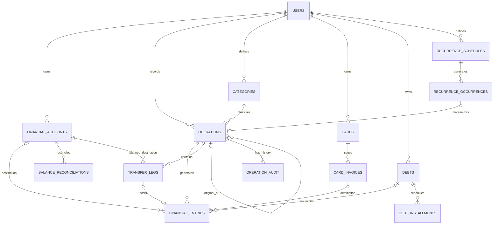

# 07 — Modelo Entidade-Relacionamento (ER) do Orbe

**Estado: proposta conceptual para validação.** Este documento transforma as regras de negócio e os objetivos das páginas num modelo de dados coerente. Não é ainda o esquema físico definitivo nem autoriza a criação de migrations.

## 1. Objetivo e princípio de desenho

O modelo deve suportar uma única realidade financeira, consultada por páginas com objetivos diferentes. O Orbe não terá uma base de dados para o Dashboard, outra para Movimentos e outra para a Rota Financeira.

O desenho assenta em três conceitos distintos:

1. **Operação:** acontecimento de negócio reconhecido pelo utilizador (despesa, receita, compra com cartão, pagamento, transferência, reversão, entre outros).
2. **Lançamento financeiro:** efeito efetivo de uma operação sobre um destino financeiro (conta, fatura ou dívida).
3. **Projeção:** cálculo temporal que combina saldos reais com acontecimentos futuros ainda não confirmados. É um resultado calculado, não um lançamento efetivo.

Esta separação preserva a regra de que só lançamentos válidos e realizados alteram saldos efetivos. Pendentes e projeções nunca são registados como efeitos financeiros realizados.

## 2. Modelo conceptual ER

O diagrama seguinte representa as entidades centrais e as relações propostas. A cardinalidade exata e algumas constraints adicionais serão fechadas no modelo físico.

**Leitura do diagrama:**
- Uma operação pode ainda não ter lançamentos (pendente) ou gerar um ou vários lançamentos quando confirmada.
- Cada lançamento aponta para exatamente um destino: conta, fatura ou dívida. É a decisão ARC-001 já aprovada.
- Uma fatura pertence a um cartão. Compras e pagamentos são operações distintas, com efeitos dirigidos à fatura e/ou à conta.
- Uma dívida pode ter várias prestações planeadas. As prestações não são novas dívidas.
- Uma programação gera ocorrências individualizadas. Uma ocorrência pode originar, no máximo, uma operação.
- Uma transferência tem duas pernas (saída e entrada), com data e estado independentes. Cada perna gera o respetivo lançamento quando realizada.
- Uma operação de correção/reversão/reembolso referencia a operação de origem; a original permanece preservada.
- Uma conferência de saldo pertence a uma conta, mas não gera lançamentos.

## 3. Entidades e responsabilidades

### 3.1 Núcleo financeiro

| Entidade | Responsabilidade | Campos conceptuais principais |
|---|---|---|
| `users` | Utilizador e preferências centrais | id, moeda principal |
| `financial_accounts` | Contas bancárias, dinheiro físico e carteiras digitais | id, user_id, tipo, nome, instituição/descrição, estado |
| `categories` | Classificação de receitas e despesas | id, user_id, nome, natureza, estado |
| `operations` | Evento de negócio visível e manipulável pelo utilizador | id, user_id, category_id, tipo, descrição, valor, estado, data efetiva, data prevista, operação de origem |
| `financial_entries` | Efeitos financeiros confirmados; fonte de verdade dos saldos | id, operation_id, destino, valor, efeito sobre o destino, data efetiva |
| `operation_audit` | Histórico técnico/funcional de alterações relevantes | id, operation_id, ator, alteração, motivo, data |

**Operação e lançamento não são sinónimos.** A operação conserva a identidade do evento. Os lançamentos registam os efeitos sobre os destinos. Uma operação de pagamento pode, por exemplo, produzir um lançamento na conta e outro na fatura ou dívida.

O valor da operação não deve ser calculado somando indiscriminadamente os valores dos seus lançamentos: em pagamentos e transferências, os vários lançamentos representam efeitos associados do mesmo montante. As métricas de receitas/despesas contam a operação uma vez, segundo a sua natureza.

### 3.2 Destinos dos lançamentos — ARC-001

A tabela `financial_entries` terá referências específicas:

- `account_id` — efeito numa conta;
- `invoice_id` — efeito numa fatura de cartão;
- `debt_id` — efeito numa dívida/obrigação.

As três referências serão opcionais individualmente, mas **exatamente uma deve estar preenchida por lançamento**. Cada uma terá uma FK real. Uma `CHECK CONSTRAINT` deve garantir o destino único. Não utilizar `destination_type + destination_id` para estes destinos.

O valor do lançamento é positivo e o campo conceptual `effect` indica se aumenta ou reduz o saldo relevante do destino:
- Conta: aumentar ou reduzir dinheiro disponível.
- Fatura/dívida: aumentar ou reduzir o valor em aberto.

A semântica do efeito depende do tipo de destino. O campo não deve ser confundido com a classificação económica da operação (receita, despesa, transferência ou liquidação).

Referências compostas ou validação transacional deverão impedir que uma operação de um utilizador aponte para conta, fatura ou dívida de outro utilizador.

### 3.3 Cartões e faturas

| Entidade | Responsabilidade | Campos conceptuais principais |
|---|---|---|
| `cards` | Cartão de crédito e condições | id, user_id, nome, limite, condições de fecho/vencimento |
| `card_invoices` | Fatura/período de um cartão | id, card_id, período, data de fecho, data de vencimento |

A utilização do cartão, o disponível e o valor em aberto são derivados das faturas e dos lançamentos associados; não devem tornar-se fontes de verdade independentes.

**Compra com cartão:** a operação de compra classifica a despesa uma única vez e gera efeito na fatura. Não reduz imediatamente o saldo de uma conta bancária.

**Pagamento da fatura:** é uma operação diferente. Gera um efeito de saída na conta utilizada e um efeito de redução do valor em aberto da fatura. Não cria uma segunda despesa.

Os detalhes físicos de compras, parcelas e associação a faturas serão afinados nas sequências UML e nas subpáginas de Cartões.

### 3.4 Dívidas e prestações

| Entidade | Responsabilidade | Campos conceptuais principais |
|---|---|---|
| `debts` | Obrigação financeira | id, user_id, nome, tipo, data de origem, condições |
| `debt_installments` | Agenda de prestações da obrigação | id, debt_id, número, data prevista, valor planeado |

Os pagamentos são operações próprias, com lançamentos na conta de origem e na dívida. Podem ser parciais e partir de contas diferentes. O saldo em aberto é derivado dos efeitos válidos dirigidos à dívida.

As prestações representam a agenda/afetação da obrigação, não uma segunda dívida. A associação explícita de cada pagamento a uma ou várias prestações ainda deve ser fechada nas regras de detalhe de Dívidas; não se deve presumir uma regra FIFO nem criar uma tabela de afetação sem essa decisão.

### 3.5 Transferências

Uma operação de transferência contém duas pernas:
- saída de uma conta;
- entrada noutra conta.

Cada perna conserva a sua própria data prevista/efetiva e estado, porque a saída e a entrada podem ser confirmadas em momentos diferentes. Quando uma perna é realizada, gera um lançamento com destino à respetiva conta. O valor e a associação entre as duas pernas são coerentes.

A interface apresenta uma única operação de transferência, não duas operações soltas. Os dois lançamentos existem para atualizar corretamente os saldos das contas. No agregado de todas as contas, uma transferência concluída não altera o património líquido.

O diagrama conceptual usa `transfer_legs`. No modelo físico será necessário impor que cada transferência tenha exatamente uma perna de saída e uma de entrada, e garantir que o lançamento associado à perna aponta para a mesma conta. Esta regra exige constraints/validação transacional; a mera cardinalidade do diagrama não a garante.

### 3.6 Recorrências

| Entidade | Responsabilidade |
|---|---|
| `recurrence_schedules` | Regra de repetição e configuração da programação |
| `recurrence_occurrences` | Ocorrências individualizadas, com data/valor/estado próprios e chave de unicidade |

Cada ocorrência pode materializar uma operação. Quando isso acontece, a projeção deve utilizar a operação gerada, e não contar também a ocorrência como outro evento. A unicidade da ocorrência e a geração idempotente impedem duplicações.

Alterações a uma ocorrência ou à ocorrência selecionada e seguintes respeitam as regras aprovadas; ocorrências passadas/realizadas não são reescritas.

### 3.7 Conferência de saldos

`balance_reconciliations` guarda a comparação entre:
- saldo calculado da conta na data da conferência;
- saldo real informado pelo utilizador;
- diferença e data da conferência.

É um registo de comparação, não um movimento. Não cria `financial_entries`, não altera o saldo calculado e não corrige diferenças artificialmente.

## 4. Regras de integridade do modelo

1. Um lançamento pertence a uma única operação.
2. Um lançamento tem exatamente um destino, protegido por FKs específicas e `CHECK`.
3. Só lançamentos válidos e realizados entram no cálculo de saldos efetivos.
4. Lançamentos confirmados não são apagados ou alterados silenciosamente.
5. Uma reversão é uma nova operação com lançamentos de efeito contrário, ligada à origem.
6. Um reembolso mantém ligação à operação de origem.
7. Uma operação pendente pode existir sem lançamentos efetivos.
8. Uma operação cancelada mantém histórico e não afeta saldos nem projeções.
9. Pagamentos parciais são operações individuais; o montante em aberto resulta dos efeitos registados.
10. A mesma operação não pode surgir repetida numa lista devido a ter vários lançamentos.
11. Transferências mantêm duas pernas associadas; cada lançamento afeta apenas a sua conta/destino.
12. Ocorrências recorrentes são únicas e a materialização em operação é idempotente.
13. Conferências de saldo não participam no livro de lançamentos.
14. Dados derivados (saldo de conta, valor em aberto, disponível do cartão e totais) podem ser guardados como cache, mas têm de ser reconstruíveis a partir das fontes de verdade.

## 5. A mesma base de dados, três objetivos de página diferentes

Esta é a distinção funcional mais importante para o desenho do Orbe:

| Página | Objetivo | Granularidade apresentada | Fonte primária | Pendentes/projeções |
|---|---|---|---|---|
| Dashboard | Resumo rápido da posição atual e atividade do mês | KPIs e operações recentes | Contas, lançamentos e operações | Sem projeções; o saldo é sempre atual |
| Movimentos | Consultar e gerir o registo operacional | Uma linha por operação | Operações, com lançamentos relacionados | Mostra estados Realizado, Pendente e Cancelado conforme filtros |
| Rota Financeira | Compreender a evolução diária e simular o futuro | Uma linha por dia, com saldo acumulado | Lançamentos realizados + fontes de eventos futuros | Inclui projeção; não transforma pendentes em realizados |

### 5.1 Dashboard — fotografia atual, não simulação

- **Saldo total:** soma dos saldos efetivos de todas as contas, calculados a partir dos lançamentos realizados com destino a conta. O seletor de mês não altera este valor.
- **Receitas e despesas do mês:** a consulta deve agrupar operações realizadas pela natureza económica, contando cada operação uma vez. Transferências e pagamentos de faturas/dívidas não são novas receitas/despesas. Uma compra com cartão conta como despesa na data da compra.
- **Últimos movimentos:** consulta operações, não linhas de lançamento. Assim, uma transferência ou um pagamento com dois lançamentos aparece uma só vez.
- **Seletor mensal:** filtra KPIs e atividade histórica; não muda o saldo atual.
- Não calcular saldo futuro nem incluir previsões nos KPIs do Dashboard.

A lista de atividade recente pode apresentar o estado da operação; o âmbito exato de inclusão de pendentes nessa lista deve respeitar o desenho final do componente, sem os incorporar em saldos efetivos.

### 5.2 Movimentos — registo de operações

- A entidade raiz da lista é `operations`, não `financial_entries`.
- Cada operação aparece uma vez, mesmo que gere vários lançamentos.
- Filtros de conta devem testar a existência de lançamento para essa conta, sem multiplicar linhas da operação.
- Filtros de categoria, tipo, data e estado aplicam-se à operação.
- As vistas de detalhe podem consultar todos os lançamentos e entidades relacionados.
- A aba Programações consulta `recurrence_schedules` e ocorrências; não mistura a regra recorrente com cada operação já materializada.
- Pendentes são visíveis e geríveis, mas não alteram o saldo efetivo.

### 5.3 Rota Financeira — simulação diária sobre o motor central

A Rota não é outra lista de operações nem outro livro contabilístico. É uma consulta de fluxo de caixa por dia, com saldo acumulado.

**Componente realizado:**
- Parte dos saldos reais no início do período.
- Usa os lançamentos efetivos dirigidos a contas, agrupados pela data efetiva.
- O saldo de cada dia é o saldo anterior mais entradas menos saídas efetivas.
- Dias sem movimentos mantêm o saldo acumulado.
- Transferências usam os efeitos de cada perna na respetiva conta/data; no total agregado, as duas pernas concluídas compensam-se.

**Componente projetado:**
- Considera operações pendentes com data/valor previstos.
- Considera ocorrências futuras de recorrências ainda não materializadas.
- Considera prestações futuras e faturas por pagar com vencimento conhecido, de acordo com as regras de projeção que vierem a ser fechadas.
- Não grava estes valores como lançamentos reais.
- A confirmação de um evento cria os lançamentos efetivos e retira o respetivo valor da projeção, sem duplicação.

**Distinção crítica para cartões:**
- A compra é reconhecida como despesa na data da compra e aparece em Movimentos/Relatórios.
- A compra não é saída imediata de uma conta bancária.
- A saída de dinheiro é projetada na data prevista de pagamento da fatura e só passa a efetiva quando o pagamento é confirmado.
- Se já existir um pagamento pendente explícito para a fatura, a Rota não pode somar também uma segunda saída automática pela mesma fatura.

**Distinção crítica para dívidas:**
- A obrigação e a agenda de prestações permitem identificar compromissos futuros.
- Um pagamento pendente já associado à prestação deve substituir, e não duplicar, a projeção dessa prestação.
- A confirmação do pagamento cria efeitos na conta e na dívida; apenas o efeito da conta entra no fluxo de caixa.

A Rota produz uma grelha diária e um saldo projetado no fim do mês. A camada de projeção deve ser um serviço/consulta derivada, não uma segunda fonte de verdade nem uma tabela de lançamentos projetados.

### 5.4 Outras páginas — fontes de leitura

| Página | Leitura principal |
|---|---|
| Contas | Contas e lançamentos realizados por conta; conferências em tabela própria |
| Cartões | Cartões, faturas e efeitos de compra/pagamento nas faturas; utilização/disponível derivados |
| Dívidas | Dívidas, lançamentos dirigidos à dívida e agenda de prestações; valor em aberto derivado |
| Relatórios | Operações realizadas e respetivas classificações; sem projeções |
| Configurações | Preferências do utilizador, moeda e categorias; não altera diretamente operações financeiras |

## 6. Consultas e cálculos que não devem ser confundidos

### Saldo de conta
Calculado apenas por lançamentos realizados cujo destino é a conta em causa. Uma conferência de saldo não é adicionada ao cálculo.

### Saldo total no Dashboard
Soma dos saldos efetivos das contas incluídas. Não é o saldo no fim do mês selecionado nem uma projeção.

### KPI de despesas
Agrega operações realizadas classificadas como despesa. Não soma todos os lançamentos associados, porque pagamentos e transferências podem gerar mais de um efeito para a mesma operação.

### Valor em aberto de fatura/dívida
Calculado pelos efeitos de aumento e redução dirigidos à fatura/dívida. Pagamentos parciais reduzem o valor em aberto sem eliminar a obrigação.

### Saldo da Rota
É uma série temporal: saldo efetivo de partida + efeitos reais por data + eventos futuros simulados. Não deve ser persistido como saldo contabilístico nem alterado pelo seletor do Dashboard.

## 7. Pontos que continuam por decidir antes do modelo físico

1. **Prestações e afetação de pagamentos:** se um pagamento pode liquidar várias prestações, como se associa explicitamente a cada uma e como se determina o estado de cada prestação.
2. **Projeção de faturas de cartão:** regra para estimar a saída quando ainda não existe pagamento explícito e tratamento de pagamentos parciais.
3. **Projeção de despesas variáveis:** a Rota usa estados de cobertura de despesas variáveis estimadas, mas a origem e o cálculo dessas estimativas não estão especificados. Não criar orçamento ou meta de poupança por inferência.
4. **Estado de transferências:** constraints para garantir exatamente uma perna de saída e uma de entrada e como tratar uma perna confirmada enquanto a outra permanece pendente.
5. **Saldos iniciais:** definir como o saldo de abertura de uma conta entra no livro sem ser classificado como receita.
6. **Precisão monetária:** tipo decimal, escala, arredondamento e política para valores parcelados.
7. **Estados específicos:** completar a máquina de estados de faturas, dívidas, prestações e ocorrências nas respetivas subpáginas.

## 8. Decisões técnicas recomendadas para o esquema físico

- Usar MySQL/InnoDB com FKs reais e índices correspondentes.
- Usar `CHECK` para destino único de cada lançamento e validações locais de valores.
- Aplicar restrições de propriedade do utilizador nas relações entre operação, lançamento e destino.
- Usar `RESTRICT`/política equivalente para impedir eliminação em cascata de dados com efeitos financeiros.
- Usar `DECIMAL` com escala a aprovar; nunca `FLOAT`/`DOUBLE` para dinheiro.
- Imutabilidade lógica dos lançamentos confirmados; correções por novas operações associadas.
- Transações de base de dados na confirmação de operações com vários lançamentos.
- Unicidade e geração idempotente para ocorrências recorrentes.
- Não criar tabelas para Dashboard, Movimentos ou Rota Financeira. São consultas/read models sobre as entidades acima.
- Índices devem decorrer dos filtros reais: user, estado, tipo, datas, categoria, destino e relações de recorrência.

## 9. Fontes técnicas de referência

- [MySQL 8.4 — Foreign Key Constraints](https://dev.mysql.com/doc/refman/8.4/en/create-table-foreign-keys.html): integridade referencial, tipos compatíveis e índices de FK.
- [MySQL 8.4 — CHECK Constraints](https://dev.mysql.com/doc/refman/8.4/en/create-table-check-constraints.html): restrições verificadas em INSERT/UPDATE.
- [Laravel 13 — Eloquent Relationships](https://laravel.com/docs/13.x/eloquent-relationships): relações 1:1, 1:N e polimórficas.
- [Laravel 13 — Database Transactions](https://laravel.com/docs/13.x/database#database-transactions): atomicidade das confirmações com vários efeitos.

A documentação técnica orienta os mecanismos; as relações e invariantes do Orbe derivam das regras de negócio aprovadas neste projeto.
