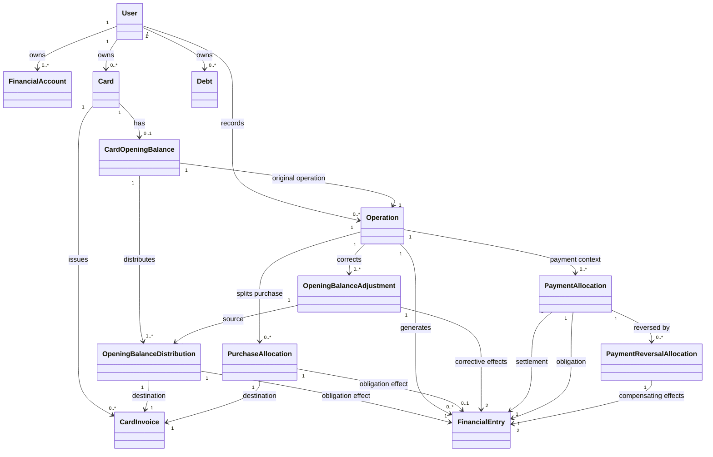
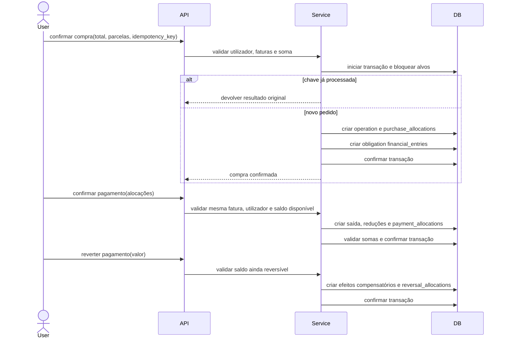
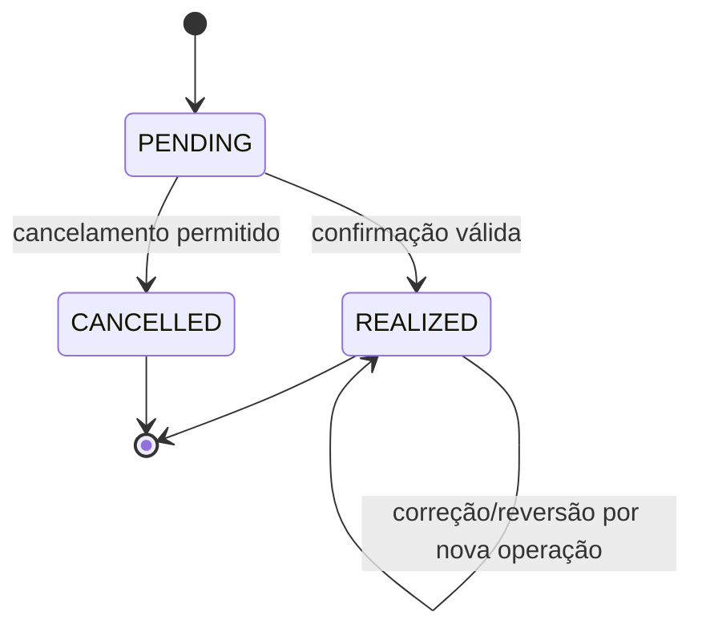
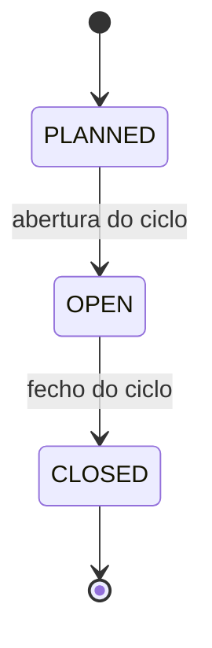
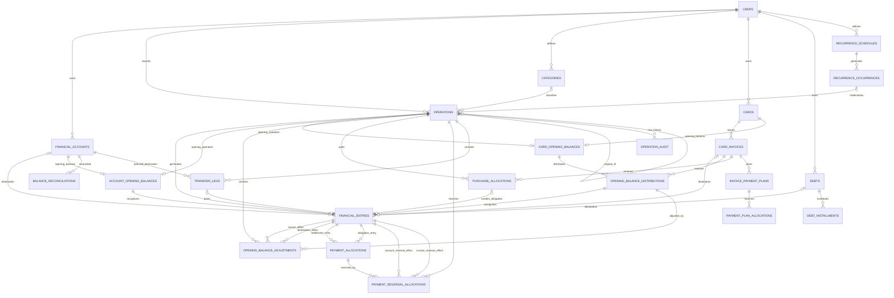

# 04 — Arquitetura, modelo e auditoria

> Documento consolidado. Arquitetura, modelo de dados e auditoria técnica são tratados neste domínio; não criar documentos separados por módulo ou etapa.

---

**Estado:** stack, monorepo, ARC-001, modelo ER conceptual (ARC-002), UML complementar e modelo físico do núcleo financeiro estão aprovados. O modelo físico de módulos ainda não implementados permanece fora deste fecho.

## 1. Stack tecnológica aprovada
- **Backend:** Laravel 13 + PHP.
- **Base de dados:** MySQL 8.4 LTS.
- **Web:** React + TypeScript + Vite.
- **Mobile:** React Native + Expo + TypeScript para Android e iOS.
- **Comunicação:** API REST com JSON, comum aos dois clientes.
- **Organização:** monorepo único.

Estrutura lógica de referência:
```text
Orbe/
├── backend/
├── web/
├── mobile/
├── docs/
├── AGENTS.md
└── README.md
```

Cada aplicação mantém as suas próprias dependências, configuração e processo de execução. Não adotar Nx, Turborepo ou outra ferramenta de orquestração nesta fase sem necessidade demonstrada.

Web e mobile terão interfaces próprias. Tipos, validações e módulos partilháveis podem ser reutilizados quando adequado; componentes visuais não precisam de ser os mesmos.

## 2. Decisões arquiteturais já tomadas
- API Laravel comum para Web, Android e iOS.
- Monorepo para Backend, Web, Mobile e documentação.
- Preferência por monólito modular.
- Motor financeiro único.
- Separação conceptual entre operação (evento de negócio) e lançamentos (efeitos), relação 1:N.
- Estados e transições controlados pelas regras de domínio.
- Integridade e rastreabilidade financeira obrigatórias.
- **ARC-001 aprovado:** cada lançamento referencia exatamente um destino através de referências específicas com FKs próprias.

## 3. Modelo conceptual e ER

O modelo ER conceptual e a sua fundamentação estão em [07 — Modelo ER](04-arquitetura-modelo-e-auditoria.md).

O documento detalha:
- Operação como evento de negócio e lançamento como efeito financeiro.
- Destinos específicos aprovados em ARC-001.
- Saldo inicial de cartão distribuído integralmente por faturas, com histórico, correções e reversões rastreáveis.
- Saldo inicial de conta reconhecido por operação original única e lançamento realizado na própria conta, sem natureza de receita/despesa; correções são rastreáveis.
- Pagamentos multi-fatura com uma saída total e reduções por fatura.
- Cartões, faturas, dívidas, prestações, transferências, recorrências e conferências.
- A diferença entre os dados efetivos e os eventos usados em projeções.
- Como Dashboard, Movimentos, Rota Financeira e restantes páginas consultam o mesmo núcleo com objetivos e granularidades diferentes.

**Estado: ARC-002 aprovado.** O modelo ER conceptual incorpora saldo inicial integralmente distribuído, correções, reversões de pagamento e pagamentos multi-fatura. O diagrama continua a ser conceptual; não aprova o esquema físico nem autoriza migrations.

## 4. ARC-001 — Destino dos lançamentos financeiros

**Estado: aprovado. Alternativa A — referências específicas.**

### 4.1 Regra aprovada
Cada lançamento financeiro identifica exatamente um destino. O destino é representado por uma referência específica à entidade correspondente, com chave estrangeira própria.

Destinos considerados no modelo atual:
- Conta financeira: `account_id`
- Fatura: `invoice_id`
- Dívida/obrigação: `debt_id`

A estrutura final das colunas e os nomes físicos serão confirmados no modelo ER e no esquema físico. A decisão aprova o padrão de referências específicas, não todos os detalhes de implementação.

### 4.2 Integridade obrigatória
- Cada referência deve ter FK para a respetiva tabela.
- Exatamente uma referência de destino deve estar preenchida por lançamento.
- Implementar a regra de destino único com `CHECK` constraint no MySQL 8.4, acompanhada de testes.
- Aplicar índices necessários às FKs e consultas.
- Impedir referências cruzadas entre utilizadores; avaliar FKs compostas ou validação transacional no domínio.
- Preservar histórico financeiro; evitar eliminação em cascata de destinos com lançamentos associados.

### 4.3 Consequências para o modelo
Uma operação pode originar vários lançamentos. Cada lançamento representa um efeito financeiro e tem o seu próprio destino. Não colocar vários destinos no mesmo lançamento.

A alternativa de associação polimórfica (`destination_type + destination_id`) não será usada para os destinos centrais do motor financeiro, pois não oferece FK SQL direta para as diferentes tabelas. A superentidade genérica também não será introduzida nesta fase, por acrescentar complexidade sem benefício de domínio demonstrado.

A decisão poderá ser revista se surgir um novo requisito que justifique uma abstração diferente, mas não deve ser alterada apenas por conveniência do ORM.

### 4.4 Fundamentação técnica registada
A comparação considerou integridade referencial, complexidade do esquema, consultas, evolução e responsabilidade da aplicação. A alternativa A foi escolhida por manter a integridade próxima dos dados, tornar as relações explícitas e evitar uma abstração genérica prematura.

Fontes técnicas:
- [MySQL 8.4 — Foreign Key Constraints](https://dev.mysql.com/doc/refman/8.4/en/create-table-foreign-keys.html)
- [MySQL 8.4 — CHECK Constraints](https://dev.mysql.com/doc/refman/8.4/en/create-table-check-constraints.html)
- [Laravel 13 — Eloquent Polymorphic Relationships](https://laravel.com/docs/13.x/eloquent-relationships#polymorphic-relationships)

## 5. Arquitetura lógica proposta
- **Interface:** clientes Web (React) e mobile (React Native).
- **Aplicação:** API, autenticação, validação, autorização e casos de uso.
- **Domínio:** operações, lançamentos, contas, cartões, faturas, obrigações, recorrências e regras financeiras.
- **Infraestrutura:** MySQL, transações, bloqueios, scheduler, filas e consultas.

O domínio não deve depender da interface. Regras financeiras não devem ser reimplementadas separadamente nos clientes.

## 6. Consistência e concorrência — princípios consolidados
- Operações que geram vários lançamentos devem ser confirmadas numa única transação.
- Pagamento multi-fatura: uma saída total na conta, reduções por fatura e respetivas alocações são atómicas; cada par redução/obrigação pertence à mesma fatura.
- Compra parcelada: operação, alocações de compra e lançamentos de obrigação são confirmados em conjunto.
- Saldo inicial de cartão: operação original única por cartão, distribuição integral por faturas e lançamentos de obrigação confirmados em conjunto.
- Saldo inicial de conta: operação original única por conta e lançamento realizado dirigido à conta, confirmado atomicamente com a criação; não é receita/despesa nem saldo manual mutável.
- Redistribuição e reversão: efeitos corretivos e relações de rastreabilidade são atómicos; não alteram lançamentos confirmados.
- Validações que abrangem várias linhas (somas, saldos restantes e alocações) exigem lógica de domínio/transação; não podem ser delegadas a um `CHECK` de linha.
- Bloquear o cartão e as linhas de obrigação/alvo numa ordem consistente antes de validar redistribuições e pagamentos concorrentes; recalcular os montantes disponíveis dentro da transação e tratar deadlocks com repetição segura.
- Usar chaves de idempotência/constraints de unicidade para impedir repetição de pagamentos, materialização de ocorrências e confirmação de compras.
- A unicidade de ciclo `OPEN` é protegida por índice `UNIQUE` sobre coluna gerada nullable e por bloqueio transacional da linha do cartão no MySQL 8.4.
- Tarefas assíncronas não podem quebrar a atomicidade dos efeitos financeiros imediatos.

## 7. Persistência e desempenho — proposta a validar
MySQL/InnoDB; índices baseados em consultas reais; análise de planos de execução; evitar N+1; paginação adequada; cache apenas de dados derivados e reconstruíveis. Não introduzir Redis, Elasticsearch ou microserviços sem necessidade demonstrada.

## 8. Precisão monetária — ARC-003

**Estado: aprovado para o núcleo financeiro.** Todos os valores monetários persistidos usam `DECIMAL(19,4)`. A aplicação usa aritmética decimal exata; `float` e `double` são proibidos em cálculos financeiros.

- Os quatro algarismos decimais são a escala canónica persistida.
- Valores com mais de quatro casas decimais são rejeitados; não há truncamento silencioso.
- Somatórios, saldos, alocações, pagamentos e reversões são calculados na escala canónica, sem arredondamento intermédio.
- Uma operação multi-linha só é confirmada quando as somas coincidem exatamente na escala canónica.
- Quando uma divisão necessária não for exata, o valor é distribuído em unidades de `0,0001`, atribuindo o resto por ordem determinística às primeiras parcelas; a soma final tem de coincidir exatamente com o total.
- O arredondamento para apresentação monetária é apenas visual, para duas casas, usando arredondamento half-up; não altera o valor persistido nem os cálculos.
- Conversões entre moeda, impostos e regras de escala de moedas não suportadas ficam fora deste contrato até existir decisão de produto.

## 9. UML a produzir e aprovar
1. ER: entidades, atributos essenciais, cardinalidades, chaves e constraints.
2. Domínio/classes: responsabilidades e relações financeiras.
3. Sequência: despesa, compra parcelada, abertura de ciclo, pagamento integral/parcial de fatura, plano vencido, saldo inicial de cartão, pagamento parcial de dívida, transferência, reversão/reembolso e recorrência.
4. Estados: transições de operações, ciclos de faturação, planos de pagamento e obrigações.
5. Modelo físico: tabelas, índices e integridade referencial, após aprovação conceptual.

### Sequência conceptual — compra parcelada
1. Confirmar uma única operação de compra.
2. Criar as alocações para os períodos de faturação identificados, incluindo períodos `PLANNED`.
3. Criar um lançamento de obrigação por alocação, com destino à respetiva fatura/período.
4. Não criar saída de conta bancária.
5. A abertura futura do ciclo altera apenas o estado operacional; não cria lançamentos.
6. A projeção de pagamentos futuros é calculada separadamente.

### Sequência conceptual — saldo inicial de cartão
1. Criar no máximo uma operação original de natureza `CARD_OPENING_BALANCE` por cartão, apenas quando o saldo inicial é positivo.
2. Exigir distribuição integral do valor por faturas/ciclos; a soma tem de coincidir exatamente com o valor declarado.
3. Criar um lançamento de obrigação por distribuição, sempre com destino `invoice_id`; não criar despesa, receita ou saída de conta.
4. Preservar as distribuições originais. Redistribuições posteriores são operações corretivas com redução na fatura de origem e aumento na fatura de destino.
5. A obrigação em aberto é reconstruída a partir dos lançamentos; as distribuições são rastreabilidade, não fonte paralela de saldo.

### Sequência conceptual — pagamento multi-fatura
1. Confirmar uma única operação de pagamento e criar uma saída total na conta.
2. Criar uma redução por cada fatura abrangida.
3. Criar `payment_allocations` entre cada redução e obrigações da mesma fatura.
4. Validar que a soma das reduções coincide com a saída e que nenhuma obrigação é liquidada acima do saldo disponível.
5. Confirmar saída, reduções e alocações na mesma transação.

### Sequência conceptual — reversão de pagamento
1. Criar uma operação de reversão ligada ao pagamento original.
2. Criar a entrada compensatória na conta e os aumentos compensatórios nas faturas afetadas.
3. Registar cada parcela revertida em `payment_reversal_allocations`, ligada à `payment_allocation` original.
4. Rejeitar reversões acumuladas superiores ao montante ainda não revertido.
5. Confirmar todos os efeitos e relações na mesma transação.

### Sequência conceptual — pagamento de fatura
1. Confirmar a operação de pagamento.
2. Criar o lançamento de saída com destino à conta.
3. Criar o lançamento de redução com destino à fatura.
4. Alocar a redução a um ou vários lançamentos de obrigação através de `payment_allocations`.
5. Validar limites e somas sob transação/bloqueio.
6. Confirmar tudo em conjunto; a operação não é uma despesa.

### Sequência conceptual — plano vencido
1. Antes da data, o plano reserva uma parcela identificada da obrigação e projeta a saída na data prevista.
2. Sem confirmação na data, o plano passa a vencido e deixa de ser saída futura nessa data passada.
3. A obrigação permanece vencida; a liquidação residual cobre apenas a parte não reservada.
4. Sem regra de débito/reagendamento automático aprovada, não criar uma nova data futura.

O ER conceptual está apresentado em [07 — Modelo ER](04-arquitetura-modelo-e-auditoria.md). As vistas UML complementares e o modelo físico do núcleo financeiro estão fechados nas secções seguintes.

## 9.1 UML complementar de domínio



`Operation` identifica o evento, `FinancialEntry` representa o efeito e as entidades de allocation explicam relações entre efeitos. Nenhuma allocation é um lançamento ou altera saldo diretamente.

## 9.2 Sequência UML — compra parcelada, pagamento e reversão



## 9.3 Máquinas de estado do núcleo implementado



Para faturas, o ciclo operacional é independente da liquidação:



Uma fatura `CLOSED` pode manter obrigação em aberto. A transição de ciclo não cria lançamentos.

## 9.4 Modelo físico fechado — núcleo financeiro

O modelo físico aprovado para o núcleo implementado é InnoDB/MySQL e corresponde às migrations versionadas em `backend/database/migrations/`.

| Tabela | Papel | Constraints relevantes |
|---|---|---|
| `financial_accounts` | Destino de efeitos em contas | `user_id` e FK de utilizador |
| `cards` | Cartões de crédito | `credit_limit DECIMAL(19,4)`, dias entre 1 e 31 |
| `debts` | Obrigações/dívidas | `user_id` e FKs restritivas |
| `card_invoices` | Ciclos de faturação | `PLANNED/OPEN/CLOSED`, período válido, uma `OPEN` por cartão |
| `operations` | Eventos de negócio | `amount DECIMAL(19,4) > 0`, estado e idempotência |
| `financial_entries` | Efeitos financeiros | `amount DECIMAL(19,4) > 0`, exatamente um destino, efeito e estado válidos |
| `purchase_allocations` | Distribuição de compra | valor positivo, no máximo uma obrigação por allocation |
| `card_opening_balances` | Saldo inicial | valor positivo, relação única cartão/operação |
| `opening_balance_distributions` | Distribuição histórica | valor positivo, fatura e obrigação associadas |
| `opening_balance_adjustments` | Correções | `REDISTRIBUTION/REVERSAL`, dois efeitos rastreáveis |
| `payment_allocations` | Liquidação de obrigações | valor positivo e par redução/obrigação |
| `payment_reversal_allocations` | Reversão rastreável | valor positivo e efeitos compensatórios |

As regras que dependem de várias linhas — somas de alocações, saldo disponível, limites acumulados, coerência entre utilizador/fatura/operação e concorrência — permanecem validações transacionais dos serviços. Não são substituídas por `CHECK` de uma única linha.

O modelo físico fechado não afirma que entidades conceptuais ainda sem migration (`recurrence_schedules`, planos, conferências e auditoria funcional) estejam implementadas. `categories` e `transfer_legs` já têm migrations e contratos mínimos versionados; as extensões restantes exigem migrations e contratos próprios antes de serem marcadas como concluídas.

## 10. Testes de arquitetura
Testar domínio sem interface, persistência/constraints, transações/concorrência, idempotência, fluxos financeiros completos e consistência entre consultas e saldos.

## 11. Decisões técnicas e de produto ainda pendentes
- Modelo físico final, cardinalidades, índices e constraints detalhadas.
- Representação monetária, escala e arredondamento (ARC-003).
- Autenticação e sessões (ARC-004).
- Alojamento, deploy e ambientes (ARC-006).
- Scheduler, filas e processamento assíncrono (ARC-007).
- Testes, CI/CD, backup e recuperação (ARC-008).
- Decisões de produto sobre débito/reagendamento automático de planos vencidos, apresentação de faturas antigas, compras no dia do fecho e crédito negativo de fatura.
- Fonte, janela, cálculo e apresentação das estimativas de despesas variáveis na Rota.

## Frontend Web

### Padrões de implementação React/TypeScript
- A página compõe a interface; componentes visuais recebem dados e callbacks por props.
- Colocar lógica derivada em hook da feature ou função pura; não duplicar regras financeiras na UI.
- Manter estado no menor âmbito adequado e não guardar estado que possa ser derivado.
- Reutilizar design system, tokens e componentes existentes; CSS local só para necessidades específicas.
- Organizar por feature quando houver responsabilidades distintas; criar apenas os módulos necessários.
- Adaptar referências visuais ao padrão React; não copiar protótipos monolíticos.
- Seguir as Rules of Hooks, manter renderização pura e não usar efeitos para sincronizar valores que podem ser derivados durante render.
- Evitar `any`, casts e supressões de lint sem motivo documentado; tipos devem refletir contratos reais.
- Evitar duplicação de variantes desktop/mobile quando a mesma composição responsiva resolve; quando variantes distintas forem necessárias, manter paridade de conteúdo/ações através de props ou lógica partilhada.
- Testar estados de carregamento, erro, vazio e dados; validar navegação por teclado, semântica, foco, tema e breakpoints.

### Política obrigatória de refatoração oportuna
A refatoração local segura é parte da implementação, não uma tarefa opcional posterior. Sempre que um agente tocar numa feature, deve avaliar e corrigir problemas diretamente relacionados e de baixo risco: duplicação, responsabilidades misturadas, estado derivável, lógica não testável, estilos/tokens contraditórios, componentes inadequadamente acoplados, APIs obsoletas e violações das convenções React/TypeScript.

- Refatorar incrementalmente, com escopo explícito, sem alterar comportamento aprovado nem contratos.
- Reutilizar componentes/hooks/utils existentes antes de criar novos; abstrair apenas quando houver responsabilidade e reutilização reais.
- Não perpetuar código inadequado com a justificação genérica “fora do escopo”.
- Refatorações transversais, mudanças de arquitetura, dependências novas ou alterações de comportamento exigem plano separado, justificação, critérios de aceitação e validação.
- Findings que não possam ser corrigidos com segurança devem ficar registados como trabalho aberto com área, impacto, dependência e critério de conclusão; não declarar a área plenamente conforme enquanto permanecerem.
- Antes de concluir, rever o diff e reportar explicitamente a avaliação de refatoração, o que foi corrigido, o que foi adiado e porquê.

Aplicar os Gates A/B/C obrigatórios de `AGENTS.md`. Validar lint, TypeScript/build, testes relevantes e QA responsiva; declarar tudo o que não foi executado.

---

**Estado: APROVADO como modelo ER conceptual / especificação de domínio (ARC-002), com o modelo físico do núcleo financeiro fechado em `04-arquitetura-modelo-e-auditoria.md`.** O modelo incorpora as regras financeiras e os fluxos refinados de cartões, faturas, compras parceladas, pagamentos, planos vencidos, transferências e reembolsos. O fecho físico aplica-se às entidades já implementadas; módulos conceptuais ainda sem migrations continuam fora do núcleo aprovado.

## 1. Objetivo e princípio de desenho

O modelo deve suportar uma única realidade financeira, consultada por páginas com objetivos diferentes. O Orbe não terá uma base de dados para o Dashboard, outra para Movimentos e outra para a Rota Financeira.

O desenho assenta em três conceitos distintos:

1. **Operação:** acontecimento de negócio reconhecido pelo utilizador (despesa, receita, compra com cartão, pagamento, transferência, reversão, entre outros).
2. **Lançamento financeiro:** efeito efetivo de uma operação sobre um destino financeiro (conta, fatura ou dívida).
3. **Projeção:** cálculo temporal que combina saldos reais com acontecimentos futuros ainda não confirmados. É um resultado calculado, não um lançamento efetivo.

Esta separação preserva a regra de que só lançamentos válidos e realizados alteram saldos efetivos. Um lançamento dirigido a uma fatura pode reconhecer uma obrigação efetiva sem representar saída de dinheiro de uma conta. Pendentes e projeções de fluxo de caixa nunca são registados como saídas efetivas de conta.

## 2. Modelo conceptual ER

O diagrama seguinte representa as entidades centrais e as relações aprovadas. A correspondência física do núcleo financeiro e as constraints implementadas estão fechadas em [04 — Arquitetura, modelo e auditoria](04-arquitetura-modelo-e-auditoria.md).



**Leitura do diagrama:**
- Uma operação de gasto/ganho pendente pode existir sem destino financeiro e sem lançamentos. O destino/instrumento não é selecionado nem apresentado enquanto permanece pendente.
- Ao realizar/confirmar gasto ou ganho, a operação tem de receber o destino/instrumento financeiro adequado antes de gerar os lançamentos efetivos; a operação realizada não pode persistir sem essa associação.
- Cada lançamento aponta para exatamente um destino: conta, fatura ou dívida. É a decisão ARC-001 já aprovada.
- Uma fatura/período pertence a um cartão. Pode estar `PLANNED`, `OPEN` ou `CLOSED`; o estado do ciclo é distinto do valor em dívida.
- Uma compra parcelada cria alocações e lançamentos de obrigação na confirmação, mesmo para períodos `PLANNED`. A abertura do ciclo não cria novos lançamentos.
- Um pagamento de fatura gera saída na conta e redução na fatura; `payment_allocations` identifica as obrigações específicas liquidadas.
- Planos de pagamento são projeções, não lançamentos; a reserva explícita e a liquidação residual não podem duplicar a mesma obrigação.
- Uma dívida pode ter várias prestações planeadas. As prestações não são novas dívidas.
- Uma programação gera ocorrências individualizadas. Uma ocorrência pode originar, no máximo, uma operação.
- Uma transferência tem duas pernas (saída e entrada), com data e estado independentes. Cada perna gera o respetivo lançamento quando realizada.
- Uma operação de correção/reversão/reembolso referencia a operação de origem; a original permanece preservada.
- Uma conferência de saldo pertence a uma conta, mas não gera lançamentos.

## 3. Entidades e responsabilidades

### 3.1 Núcleo financeiro

| Entidade | Responsabilidade | Campos conceptuais principais |
|---|---|---|
| `users` | Utilizador e preferências centrais | id, moeda principal |
| `financial_accounts` | Contas bancárias, dinheiro físico e carteiras digitais | id, user_id, tipo, nome, instituição/descrição, estado |
| `account_opening_balances` | Registo da posição inicial da conta no início da utilização do Orbe | id, account_id, operation_id, declared_amount, opening_entry_id, effective_at |
| `categories` | Classificação de receitas e despesas | id, user_id, nome, natureza, estado |
| `operations` | Evento de negócio visível e manipulável pelo utilizador | id, user_id, category_id, tipo, descrição, valor, estado, data efetiva, data prevista, operação de origem |
| `financial_entries` | Efeitos financeiros confirmados; fonte de verdade dos saldos/obrigações | id, operation_id, destino ARC-001, valor, efeito sobre o destino, data efetiva, purchase_allocation_id quando for obrigação de compra parcelada |
| `operation_audit` | Histórico técnico/funcional de alterações relevantes | id, operation_id, ator, alteração, motivo, data |

**Operação e lançamento não são sinónimos.** A operação conserva a identidade do evento. Os lançamentos registam os efeitos sobre os destinos. Uma operação de pagamento pode, por exemplo, produzir um lançamento na conta e outro na fatura ou dívida.

O valor da operação não deve ser calculado somando indiscriminadamente os valores dos seus lançamentos: em pagamentos e transferências, os vários lançamentos representam efeitos associados do mesmo montante. As métricas de receitas/despesas contam a operação uma vez, segundo a sua natureza.

### 3.2 Destinos dos lançamentos — ARC-001

A tabela `financial_entries` terá referências específicas:

- `account_id` — efeito numa conta;
- `invoice_id` — efeito numa fatura de cartão;
- `debt_id` — efeito numa dívida/obrigação.

As três referências serão opcionais individualmente, mas **exatamente uma deve estar preenchida por lançamento**. Cada uma terá uma FK real. Uma `CHECK CONSTRAINT` deve garantir o destino único. Não utilizar `destination_type + destination_id` para estes destinos.

O valor do lançamento é positivo e o campo conceptual `effect` indica se aumenta ou reduz o saldo relevante do destino:
- Conta: aumentar ou reduzir dinheiro disponível.
- Fatura/dívida: aumentar ou reduzir o valor em aberto.

A semântica do efeito depende do tipo de destino. O campo não deve ser confundido com a classificação económica da operação (receita, despesa, transferência ou liquidação).

Referências compostas ou validação transacional deverão impedir que uma operação de um utilizador aponte para conta, fatura ou dívida de outro utilizador.

### 3.3 Cartões, ciclos, compras parceladas e faturas

| Entidade | Responsabilidade | Campos conceptuais principais |
|---|---|---|
| `cards` | Cartão de crédito e condições | id, user_id, nome, limite, condições de fecho/vencimento |
| `card_invoices` | Período/fatura de um cartão | id, card_id, período, data de fecho, data de vencimento, estado do ciclo |
| `purchase_allocations` | Distribuição de uma compra pelos períodos de faturação | id, purchase_operation_id, invoice_id, amount |
| `invoice_payment_plans` | Intenção de pagamento e data prevista | id, invoice_id, operation_id, amount, planned_date, state |
| `payment_plan_allocations` | Parcela da obrigação reservada por um plano | id, payment_plan_id, obligation_entry_id, amount |
| `payment_allocations` | Associação entre redução de fatura e obrigações liquidadas | id, payment_operation_id, settlement_entry_id, obligation_entry_id, amount |
| `payment_reversal_allocations` | Rastreabilidade da reversão de uma alocação de pagamento | id, reversal_operation_id, original_payment_allocation_id, account_reversal_entry_id, invoice_reversal_entry_id, amount |

#### Ciclos e faturas

`card_invoices` representa o período interno de faturação e a sua apresentação operacional. Estados conceptuais do ciclo:
- `PLANNED`: período futuro identificado, ainda não aberto na interface;
- `OPEN`: ciclo operacional atual;
- `CLOSED`: ciclo encerrado.

O estado do ciclo não é o estado da obrigação. Um ciclo `CLOSED` pode continuar com valor em dívida; podem existir várias faturas anteriores com obrigação pendente. No máximo uma fatura por cartão pode estar em `OPEN`.

No MySQL 8.4, a unicidade de `OPEN` deve ser protegida por uma coluna gerada nullable (por exemplo, chave igual a `card_id` apenas quando o ciclo está `OPEN`, caso contrário `NULL`) com índice `UNIQUE`. A abertura deve ocorrer em transação, bloqueando a linha do cartão com `SELECT ... FOR UPDATE`; o índice único é a proteção final. Também deve existir unicidade de `(card_id, billing_period)`.

#### Compra com cartão e alocações

A compra com cartão é uma operação económica única. Na confirmação:
1. reconhecer a despesa uma única vez pelo valor total;
2. criar as `purchase_allocations` que distribuem o valor pelos ciclos;
3. criar um lançamento de obrigação por alocação, com destino à fatura/período correspondente, mesmo quando o ciclo está `PLANNED`;
4. não criar saída de conta bancária.

A abertura posterior do período apenas altera estado e apresentação. Não cria lançamentos adicionais. Para uma compra de 1.200 € em quatro parcelas, a despesa é 1.200 € e as quatro obrigações são 300 € cada; não são quatro operações de despesa.

Relação proposta: `financial_entries.purchase_allocation_id` referencia `purchase_allocations.id`, com `UNIQUE` para garantir no máximo um lançamento de obrigação por alocação. A soma das alocações deve igualar o valor da compra e exige validação transacional/domínio. O lançamento continua a ter `invoice_id` como único destino ARC-001; `purchase_allocation_id` é referência de rastreabilidade, não um segundo destino.

#### Pagamento e alocação às obrigações

Um pagamento confirmado pode abranger uma ou várias faturas. Gera uma única saída total na conta e um lançamento de redução por cada fatura abrangida. `payment_allocations` liga cada lançamento de redução (`settlement_entry_id`) aos lançamentos originais de obrigação (`obligation_entry_id`) que liquida. Cada par de redução/obrigação pertence à mesma fatura; a operação de pagamento pode abranger faturas diferentes.

Invariantes:
- todos os registos envolvidos pertencem ao mesmo utilizador;
- cada par `settlement_entry`/`obligation_entry` pertence à mesma fatura;
- todos os lançamentos de redução pertencem à mesma operação de pagamento;
- a soma das reduções por fatura corresponde ao valor da saída total na conta;
- a soma das alocações corresponde a cada redução de fatura;
- a soma alocada a uma obrigação não ultrapassa o seu saldo restante;
- uma alocação não é lançamento e não altera saldos diretamente;
- a saída, todas as reduções e todas as alocações são confirmadas na mesma transação;
- validações multi-linha exigem bloqueio/transação; não podem depender apenas de `CHECK` de linha;
- repetição do pedido de pagamento é idempotente.

#### Reversão de pagamentos

`payment_allocations` regista apenas a liquidação original. A reversão é rastreada por uma relação própria, `payment_reversal_allocations`, que associa a operação de reversão à alocação original e aos efeitos financeiros compensatórios.

Cada registo identifica a `payment_allocation` original, o lançamento de entrada na conta, o lançamento de aumento da obrigação na mesma fatura e o montante revertido. A soma das reversões associadas a uma alocação nunca pode exceder o valor original dessa alocação. Reversões parciais são permitidas; o saldo ainda reversível é calculado considerando todas as reversões anteriores.

A operação de reversão, os efeitos na conta e nas faturas e as relações de rastreabilidade são atómicos. A reversão não apaga nem altera a liquidação original. Uma reversão pode abranger várias alocações originais, mantendo uma única operação de reversão e uma única entrada total na conta, com aumentos por fatura e relações específicas por alocação compensada.

#### Planos de pagamento e projeção

`invoice_payment_plans` e `payment_plan_allocations` representam intenção e reserva para projeção, não efeitos realizados. Os lançamentos efetivos só surgem quando o pagamento é confirmado.

- A projeção explícita cobre apenas a parte da obrigação reservada pelo plano.
- A liquidação residual automática cobre apenas a obrigação não reservada.
- Um plano não confirmado na data prevista passa a vencido; deixa de ser uma saída futura na data passada, mas a obrigação permanece em aberto/vencida.
- O valor vencido não é automaticamente reagendado para uma nova data sem regra de produto aprovada.
- Cancelar ou alterar um plano liberta/atualiza a reserva de forma auditada.
- A confirmação substitui a projeção correspondente por efeitos efetivos, sem duplicação.
- Para uma mesma obrigação, pagamentos realizados, reservas ativas e residual projetado não podem exceder o saldo em aberto, salvo política explícita de crédito aprovada.

#### Saldo inicial do cartão e distribuição por faturas

O saldo já utilizado antes da entrada do utilizador no Orbe é registado por uma operação própria, de natureza `CARD_OPENING_BALANCE`. Esta operação não é compra, despesa, receita nem pagamento e não gera saída de conta. Cada efeito financeiro que reconhece o saldo inicial aponta diretamente para uma fatura através de `invoice_id`, preservando ARC-001.

Na criação do cartão:
- saldo inicial igual a zero: não é necessária operação de saldo inicial;
- saldo inicial positivo: é obrigatória a distribuição integral por faturas/ciclos;
- a soma das distribuições iniciais tem de ser exatamente igual ao saldo informado;
- não existe parcela por distribuir;
- os ciclos futuros podem estar em `PLANNED`, sem aparecerem como várias faturas abertas na interface.

Entidades conceptuais:
| Entidade | Responsabilidade | Campos conceptuais principais |
|---|---|---|
| `card_opening_balances` | Extensão 1:1 da operação original, associando-a a um cartão | id, card_id, operation_id, declared_amount |
| `opening_balance_distributions` | Distribuição histórica inicial, imutável, por fatura | id, opening_balance_id, invoice_id, amount, obligation_entry_id |
| `opening_balance_adjustments` | Correção/redistribuição posterior, ligada à distribuição e à operação corretiva | id, source_distribution_id, correction_operation_id, adjustment_type, source_entry_id, destination_invoice_id, source_reduction_entry_id, destination_increase_entry_id, reverses_adjustment_id quando aplicável, amount |

Cardinalidades e limites:
- Um cartão tem zero ou uma operação original de saldo inicial; a extensão `card_opening_balances` é única por cartão e por operação.
- Uma operação original pertence a um único cartão e pode originar uma ou várias distribuições.
- Cada distribuição inicial pertence a uma única operação original e a uma fatura; gera um lançamento de obrigação com destino à mesma fatura.
- Uma operação corretiva pode ajustar várias distribuições; cada ajuste identifica a obrigação de origem, a fatura de destino e os dois lançamentos corretivos.
- Uma correção nunca constitui uma segunda operação original.
- `opening_balance_distributions` preserva a distribuição histórica inicial. Não se atualiza silenciosamente o seu valor ou `invoice_id`.

A distribuição histórica inicial mantém-se igual ao valor reconhecido, mesmo depois de pagamentos. Correções/redistribuições são registadas separadamente por efeitos: redução na fatura de origem e aumento na fatura de destino. A obrigação em aberto é sempre reconstruída a partir de `financial_entries` válidos; as tabelas de distribuição servem para proveniência e rastreabilidade, não para manter um saldo paralelo.

Para cada distribuição, a posição vigente considera o valor original, os ajustes de entrada/saída e as liquidações/reversões associadas aos lançamentos da sua linhagem. O montante redistribuível é apenas a parcela ainda não liquidada nem comprometida por correções anteriores. Exemplo: distribuição de 1.000 €, correção de 300 € para outra fatura e pagamento líquido de 400 € deixam 300 € disponíveis para nova redistribuição. O cálculo considera todos os efeitos acumulados, não apenas o valor da linha original.

A reversão de uma distribuição ou correção cria novos efeitos contrários associados ao evento original. O registo corretivo identifica o tipo de ajuste e, quando reverte uma correção anterior, referencia-a explicitamente por `reverses_adjustment_id`; quando reverte a distribuição inicial, referencia a distribuição original. O valor revertido não pode exceder o montante ainda reversível, considerando correções posteriores e pagamentos líquidos. Valores já liquidados não podem ser redistribuídos nem revertidos como se continuassem disponíveis.

A criação do saldo inicial, as distribuições e os respetivos lançamentos são atómicos e idempotentes. A repetição do mesmo comando não pode criar uma segunda operação original, duplicar distribuições ou duplicar lançamentos.

### 3.4 Saldo inicial de conta

O saldo existente numa conta antes de começar a utilizá-la no Orbe é reconhecido por uma operação própria `ACCOUNT_OPENING_BALANCE`. A abertura representa a posição de partida na data de início de utilização no Orbe; não importa automaticamente movimentos históricos anteriores.

- Uma conta tem zero ou uma operação original de abertura. Saldo inicial zero não cria operação nem lançamento.
- A operação de abertura gera um lançamento realizado com destino à própria conta. O valor do lançamento é positivo; o efeito é `INCREASE` para saldo declarado positivo e `DECREASE` para saldo declarado negativo, quando permitido pelo tipo de conta.
- A operação não é receita, despesa, transferência nem conferência; é excluída da DRE e dos KPIs de receitas/despesas.
- A entidade conceptual `account_opening_balances` relaciona de forma única a conta, a operação original e o lançamento de abertura; `declared_amount` preserva o valor assinado informado e `effective_at` identifica a data de início de utilização.
- A criação da conta, a operação e o lançamento são atómicos e idempotentes.
- O valor e o lançamento originais são imutáveis por edição comum. Correções posteriores são operações/efeitos corretivos rastreáveis, não uma segunda abertura.
- O saldo atual é derivado da soma dos efeitos dos lançamentos realizados válidos da conta, incluindo a abertura. Não existe saldo manual paralelo.

### 3.5 Dívidas e prestações

| Entidade | Responsabilidade | Campos conceptuais principais |
|---|---|---|
| `debts` | Obrigação financeira | id, user_id, nome, tipo, data de origem, condições |
| `debt_installments` | Agenda de prestações da obrigação | id, debt_id, número, data prevista, valor planeado |

Os pagamentos são operações próprias, com lançamentos na conta de origem e na dívida. Podem ser parciais e partir de contas diferentes. O saldo em aberto é derivado dos efeitos válidos dirigidos à dívida.

As prestações representam a agenda/afetação da obrigação, não uma segunda dívida. A associação explícita de cada pagamento a uma ou várias prestações ainda deve ser fechada nas regras de detalhe de Dívidas; não se deve presumir uma regra FIFO nem criar uma tabela de afetação sem essa decisão.

### 3.5 Transferências

Uma operação de transferência contém exatamente duas pernas conceptuais: uma saída (`OUT`) e uma entrada (`IN`). Cada perna conserva a sua própria data prevista/efetiva e estado `PENDING`, `REALIZED` ou `CANCELLED`. Quando realizada, gera um lançamento com destino à respetiva conta. O valor e a associação entre as duas pernas são coerentes.

A interface apresenta uma única operação de transferência, não duas operações soltas. Os dois lançamentos existem para atualizar corretamente os saldos das contas. No agregado de todas as contas, uma transferência concluída não altera o património líquido.

O estado global é derivado das duas pernas: pendente/pendente = planeada; realizada/pendente ou pendente/realizada = parcial; realizada/realizada = concluída; cancelada/cancelada = cancelada. Combinações de uma perna realizada com a outra cancelada são exceções de liquidação e exigem ação corretiva explícita; não se pode apagar ou cancelar o efeito já realizado.

A diferença entre saídas realizadas e entradas realizadas deve ser apresentada como desequilíbrio de liquidação (saída não correspondida ou entrada não correspondida), não como saldo de caixa adicional nem como terceiro lançamento. Uma entrada realizada antes da saída aumenta efetivamente a conta de destino, mas permanece identificada como perna não correspondida.

No modelo físico será necessário impor exatamente uma perna `OUT` e uma `IN`, valor coerente, unicidade por operação/direção e correspondência entre perna, conta e lançamento. A validação exige constraints e transação; a mera cardinalidade do diagrama não a garante.

### 3.6 Recorrências e classificação

| Entidade | Responsabilidade |
|---|---|
| `recurrence_schedules` | Regra de repetição e configuração da programação |
| `recurrence_occurrences` | Ocorrências individualizadas, com data/valor/estado próprios e chave de unicidade |

Cada ocorrência pode materializar uma operação. Enquanto a ocorrência de gasto/ganho estiver pendente, não exige nem mantém conta, cartão ou outro destino financeiro. Ao materializar/confirmar como realizado, o destino adequado deve ser fornecido e validado antes dos efeitos. Quando isso acontece, a projeção deve utilizar a operação gerada, e não contar também a ocorrência como outro evento. A unicidade da ocorrência e a geração idempotente impedem duplicações.

A classificação para estimativas da Rota tem precedência: operação → ocorrência → programação → categoria → `UNCLASSIFIED`. A classificação resolvida deve ficar materializada na operação para preservar histórico. `EXCLUDED` significa excluída apenas da estimativa variável; `UNCLASSIFIED` não pode ser silenciosamente tratada como zero ou como variável. A categoria fornece o padrão; programação, ocorrência e operação podem substituí-lo nessa ordem de especificidade.

Alterações a uma ocorrência ou à ocorrência selecionada e seguintes respeitam as regras aprovadas; ocorrências passadas/realizadas não são reescritas.

### 3.7 Conferência de saldos

`balance_reconciliations` guarda a comparação entre:
- saldo calculado da conta na data da conferência;
- saldo real informado pelo utilizador;
- diferença e data da conferência.

É um registo de comparação, não um movimento. Não cria `financial_entries`, não altera o saldo calculado e não corrige diferenças artificialmente.

## 4. Regras de integridade do modelo

1. Um lançamento pertence a uma única operação.
2. Um lançamento tem exatamente um destino, protegido por FKs específicas e `CHECK`.
3. Só lançamentos válidos e realizados entram no cálculo de saldos efetivos.
4. Lançamentos confirmados não são apagados ou alterados silenciosamente.
5. Uma reversão é uma nova operação com lançamentos de efeito contrário, ligada à origem.
6. Um reembolso mantém ligação à operação de origem.
7. Uma operação pendente pode existir sem lançamentos efetivos.
8. Uma operação cancelada mantém histórico e não afeta saldos nem projeções.
9. Pagamentos parciais são operações individuais; o montante em aberto resulta dos efeitos registados.
10. A mesma operação não pode surgir repetida numa lista devido a ter vários lançamentos.
11. Transferências mantêm duas pernas associadas; cada lançamento afeta apenas a sua conta/destino.
12. Ocorrências recorrentes são únicas e a materialização em operação é idempotente.
13. Conferências de saldo não participam no livro de lançamentos.
14. Dados derivados (saldo de conta, valor em aberto, disponível do cartão e totais) podem ser guardados como cache, mas têm de ser reconstruíveis a partir das fontes de verdade.
15. Cada alocação de compra cria no máximo um lançamento de obrigação; abrir um ciclo não cria novos lançamentos.
16. Pagamento de fatura liga o lançamento de redução às obrigações liquidadas por alocações explícitas.
17. Planos de pagamento e reservas de projeção não são lançamentos efetivos.
18. A soma de pagamentos alocados a uma obrigação não pode exceder o seu saldo restante.
19. Ciclos `PLANNED`, `OPEN` e `CLOSED` são estados operacionais; não representam diretamente o estado de liquidação da obrigação.
20. Transferências têm uma perna `OUT` e uma `IN`; estados globais são derivados e não apagam efeitos realizados.
21. Um cartão tem zero ou uma operação original de saldo inicial; o saldo inicial positivo é integralmente distribuído por faturas.
21a. Uma conta tem zero ou uma operação original `ACCOUNT_OPENING_BALANCE`; a abertura é um lançamento realizado na conta, excluído de receitas/despesas, e não pode ser sobrescrita.
22. A distribuição histórica inicial é imutável; correções e redistribuições são novos efeitos rastreáveis.
23. A obrigação em aberto e o saldo utilizado são derivados de `financial_entries`, nunca das tabelas de distribuição isoladamente.
24. Uma redistribuição só pode consumir obrigação ainda não liquidada e não comprometida por correções anteriores.
25. Reversões de pagamento referenciam as alocações originais e não podem exceder o valor ainda não revertido.
26. Um pagamento multi-fatura tem uma saída total, reduções por fatura e alocações por par de lançamentos da mesma fatura; todos os efeitos são atómicos.
27. Criação do saldo inicial, correções, redistribuições e reversões são idempotentes.

## 5. A mesma base de dados, três objetivos de página diferentes

Esta é a distinção funcional mais importante para o desenho do Orbe:

| Página | Objetivo | Granularidade apresentada | Fonte primária | Pendentes/projeções |
|---|---|---|---|---|
| Dashboard | Resumo rápido da posição atual e atividade do mês | KPIs e operações recentes | Contas, lançamentos e operações | Sem projeções; o saldo é sempre atual |
| Movimentos | Consultar e gerir o registo operacional | Uma linha por operação | Operações, com lançamentos relacionados | Mostra estados Realizado, Pendente e Cancelado conforme filtros |
| Rota Financeira | Compreender a evolução diária e simular o futuro | Uma linha por dia, com saldo acumulado | Lançamentos realizados + fontes de eventos futuros | Inclui projeção; não transforma pendentes em realizados |

### 5.1 Dashboard — fotografia atual, não simulação

- **Saldo total:** soma dos saldos efetivos de todas as contas, calculados a partir dos lançamentos realizados com destino a conta. O seletor de mês não altera este valor.
- **Receitas e despesas do mês:** a consulta deve agrupar operações realizadas pela natureza económica, contando cada operação uma vez. Transferências e pagamentos de faturas/dívidas não são novas receitas/despesas. Uma compra com cartão conta como despesa na data da compra.
- **Últimos movimentos:** consulta operações, não linhas de lançamento. Assim, uma transferência ou um pagamento com dois lançamentos aparece uma só vez.
- **Seletor mensal:** filtra KPIs e atividade histórica; não muda o saldo atual.
- Não calcular saldo futuro nem incluir previsões nos KPIs do Dashboard.

A lista de atividade recente pode apresentar o estado da operação; o âmbito exato de inclusão de pendentes nessa lista deve respeitar o desenho final do componente, sem os incorporar em saldos efetivos.

### 5.2 Movimentos — registo de operações

- A entidade raiz da lista é `operations`, não `financial_entries`.
- Cada operação aparece uma vez, mesmo que gere vários lançamentos.
- Filtros de conta devem testar a existência de lançamento para essa conta, sem multiplicar linhas da operação.
- Filtros de categoria, tipo, data e estado aplicam-se à operação.
- As vistas de detalhe podem consultar todos os lançamentos e entidades relacionados.
- A aba Programações consulta `recurrence_schedules` e ocorrências; não mistura a regra recorrente com cada operação já materializada.
- Pendentes são visíveis e geríveis, mas não alteram o saldo efetivo.

### 5.3 Rota Financeira — simulação diária sobre o motor central

A Rota não é outra lista de operações nem outro livro contabilístico. É uma consulta de fluxo de caixa por dia, com saldo acumulado.

**Componente realizado:**
- Parte dos saldos reais no início do período.
- Usa os lançamentos efetivos dirigidos a contas, agrupados pela data efetiva.
- O saldo de cada dia é o saldo anterior mais entradas menos saídas efetivas.
- Dias sem movimentos mantêm o saldo acumulado.
- Transferências usam os efeitos de cada perna na respetiva conta/data; no total agregado, as duas pernas concluídas compensam-se.

**Componente projetado:**
- Considera operações pendentes com data/valor previstos.
- Considera ocorrências futuras de recorrências ainda não materializadas.
- Considera prestações futuras e faturas por pagar com vencimento conhecido, de acordo com as regras de projeção que vierem a ser fechadas.
- Não grava estes valores como lançamentos reais.
- A confirmação de um evento cria os lançamentos efetivos e retira o respetivo valor da projeção, sem duplicação.

**Distinção crítica para cartões:**
- A compra é reconhecida como despesa na data da compra e aparece em Movimentos/Relatórios.
- A compra não é saída imediata de uma conta bancária.
- A saída de dinheiro é projetada na data prevista de pagamento da fatura e só passa a efetiva quando o pagamento é confirmado.
- Se já existir um pagamento pendente explícito para a fatura, a Rota não pode somar também uma segunda saída automática pela mesma obrigação.
- Planos não confirmados na data prevista passam a vencidos; deixam de ser eventos futuros na data passada, mas a obrigação continua vencida e visível.
- A liquidação residual automática cobre apenas o saldo não reservado por planos explícitos.
- Sem regra aprovada de débito automático/reagendamento, a Rota não inventa uma nova data futura para obrigações vencidas.

**Distinção crítica para dívidas:**
- A obrigação e a agenda de prestações permitem identificar compromissos futuros.
- Um pagamento pendente já associado à prestação deve substituir, e não duplicar, a projeção dessa prestação.
- A confirmação do pagamento cria efeitos na conta e na dívida; apenas o efeito da conta entra no fluxo de caixa.

A Rota produz uma grelha diária e um saldo projetado no fim do mês. A camada de projeção deve ser um serviço/consulta derivada, não uma segunda fonte de verdade nem uma tabela de lançamentos projetados.

### 5.4 Outras páginas — fontes de leitura

| Página | Leitura principal |
|---|---|
| Contas | Contas e lançamentos realizados por conta; conferências em tabela própria |
| Cartões | Cartões, faturas e efeitos de compra/pagamento nas faturas; utilização/disponível derivados |
| Dívidas | Dívidas, lançamentos dirigidos à dívida e agenda de prestações; valor em aberto derivado |
| Relatórios | Operações realizadas e respetivas classificações; sem projeções |
| Configurações | Preferências do utilizador, moeda e categorias; não altera diretamente operações financeiras |

## 6. Consultas e cálculos que não devem ser confundidos

### Saldo de conta
Calculado apenas por lançamentos realizados cujo destino é a conta em causa. Uma conferência de saldo não é adicionada ao cálculo.

### Saldo total no Dashboard
Soma dos saldos efetivos das contas incluídas. Não é o saldo no fim do mês selecionado nem uma projeção.

### KPI de despesas
Agrega operações realizadas classificadas como despesa. Não soma todos os lançamentos associados, porque pagamentos e transferências podem gerar mais de um efeito para a mesma operação.

### Valor em aberto de fatura/dívida
Calculado pelos efeitos de aumento e redução dirigidos à fatura/dívida. Pagamentos parciais reduzem o valor em aberto sem eliminar a obrigação.

### Saldo da Rota
É uma série temporal: saldo efetivo de partida + efeitos reais por data + eventos futuros simulados. Não deve ser persistido como saldo contabilístico nem alterado pelo seletor do Dashboard.

## 7. Pontos pendentes fora do núcleo físico fechado

1. **Saldo inicial de contas:** definir como o saldo de abertura entra no livro sem ser classificado como receita.
2. **Precisão monetária:** fechada para o núcleo como `DECIMAL(19,4)` e apresentação half-up a duas casas; permanece por detalhar apenas para moedas adicionais não aprovadas.
3. **Máquinas de estado:** completar estados e transições de faturas, planos de pagamento, dívidas, prestações, ocorrências e exceções de transferências.
4. **Projeção variável da Rota:** origem, janela histórica, fórmula, distribuição diária e tratamento visual de valores `UNCLASSIFIED`.
5. **Políticas de produto:** débito/reagendamento automático de planos vencidos; apresentação de faturas antigas; compras no dia do fecho; crédito negativo de fatura.
6. **Detalhes de apresentação:** como mostrar obrigações de ciclos anteriores sem confundir estado do ciclo com estado de pagamento.

As regras conceptuais do saldo inicial distribuído, das correções, dos pagamentos multi-fatura e das reversões estão especificadas neste documento. Os pontos acima não devem ser resolvidos por inferência durante a implementação.

## 8. Decisões técnicas recomendadas para o esquema físico

- Usar MySQL/InnoDB com FKs reais e índices correspondentes.
- Usar `CHECK` para destino único de cada lançamento e validações locais de valores.
- Aplicar FKs/restrições compostas ou validação transacional para propriedade do utilizador e coerência entre operação, lançamento, fatura e alocação.
- Usar `RESTRICT`/política equivalente para impedir eliminação em cascata de dados com efeitos financeiros.
- Usar `DECIMAL(19,4)` no núcleo financeiro; nunca `FLOAT`/`DOUBLE` para dinheiro.
- Imutabilidade lógica dos lançamentos confirmados; correções por novas operações associadas.
- Transações de base de dados na confirmação de compras parceladas e pagamentos com múltiplos lançamentos.
- Bloqueio das obrigações/alvos antes de validar alocações concorrentes; somas multi-linha exigem lógica transacional.
- Unicidade e geração idempotente para ocorrências recorrentes, compras, pagamentos, criação de saldo inicial, correções/redistribuições, reversões e abertura de ciclos.
- Para redistribuições e pagamentos concorrentes, bloquear o cartão e os lançamentos de obrigação envolvidos numa ordem consistente; recalcular a disponibilidade dentro da transação e repetir com segurança em caso de conflito.
- Os comandos de criação do saldo inicial, redistribuição e reversão devem ter chave de idempotência com unicidade no âmbito do utilizador e do tipo de comando; a repetição devolve o resultado original sem gerar novos efeitos.
- Para uma fatura `OPEN` por cartão no MySQL 8.4: coluna gerada nullable com índice `UNIQUE`, combinada com `SELECT ... FOR UPDATE` na linha do cartão; unicidade adicional de cartão/período.
- Não criar tabelas para Dashboard, Movimentos ou Rota Financeira. São consultas/read models sobre as entidades acima.
- A Rota Financeira usa o endpoint autenticado `GET /api/financial-route?month=YYYY-MM`, implementado como read model Laravel (`FinancialRouteReadService`) numa transação de leitura. O endpoint não persiste saldos projetados: deriva o saldo de lançamentos realizados e acumula operações pendentes/faturas ainda por pagar, devolvendo valores DECIMAL em strings.
- O resumo de faturas é uma regra comum (`CardInvoiceSummaryService`) e é agregado em lote para os read models de cartões, faturas e Rota; não duplicar a fórmula de saldo aberto nem consultar individualmente cada fatura.
- React apresenta o read model e associa IDs a detalhes já carregados; não implementa cálculo financeiro de saldo/projeção. O endpoint devolve 24 meses consecutivos a partir do mês solicitado; React renderiza os 24 meses no desktop em grelha de três colunas e, no mobile, apresenta apenas o primeiro mês da janela. A aplicação segue automaticamente o mês atual enquanto o período estiver no modo de acompanhamento; uma seleção manual de outro mês é preservada até o utilizador regressar ao mês atual. A janela é uma consulta parametrizada, não uma tabela ou entidade de projeção.
- Índices devem decorrer dos filtros reais: user, estado, tipo, datas, categoria, destino e relações de recorrência.

## 9. Fontes técnicas de referência

- [MySQL 8.4 — Foreign Key Constraints](https://dev.mysql.com/doc/refman/8.4/en/create-table-foreign-keys.html): integridade referencial, tipos compatíveis e índices de FK.
- [MySQL 8.4 — CHECK Constraints](https://dev.mysql.com/doc/refman/8.4/en/create-table-check-constraints.html): restrições verificadas em INSERT/UPDATE.
- [Laravel 13 — Eloquent Relationships](https://laravel.com/docs/13.x/eloquent-relationships): relações 1:1, 1:N e polimórficas.
- [Laravel 13 — Database Transactions](https://laravel.com/docs/13.x/database#database-transactions): atomicidade das confirmações com vários efeitos.

A documentação técnica orienta os mecanismos; as relações e invariantes do Orbe derivam das regras de negócio aprovadas neste projeto.

## 10. Estado de aprovação

O modelo ER conceptual está formalmente aprovado como especificação de domínio. O esquema físico do núcleo financeiro, migrations versionadas, tipos monetários `DECIMAL(19,4)` e constraints correspondentes estão aprovados conforme a secção 9.4 de [04 — Arquitetura, modelo e auditoria](04-arquitetura-modelo-e-auditoria.md). As decisões de produto ainda listadas na secção 7 e os módulos sem migrations não são considerados implementados.

---

> Auditoria realizada em 2026-11-24 após o fecho do modelo físico do núcleo financeiro.

## Veredicto

O núcleo financeiro implementado está coberto por migrations, modelos, serviços, controllers, constraints e testes para os fluxos de cartões/faturas já suportados, operações base da Fase 1 e transferências de duas pernas da Fase 2. A validação é concluída para este perímetro.

O ER conceptual também descreve módulos que ainda não existem fisicamente no backend. A Fase 3 de recorrências passou a ter contrato mínimo e implementação própria. A gestão completa de dívidas continua fora do perímetro implementado.

## Matriz de cobertura do núcleo implementado

| Conceito/fluxo | Migration/tabela | Serviço/API | Validação/testes | Estado |
|---|---|---|---|---|
| Contas financeiras como destinos | `financial_accounts` | usado pelos serviços financeiros | isolamento e invariantes dos serviços | Implementado no núcleo |
| Cartões | `cards` | leitura autenticada | autorização e leitura | Implementado |
| Ciclos/faturas | `card_invoices` | leitura autenticada | unicidade de `OPEN`, estado e período | Implementado |
| Operações | `operations` | controller financeiro | idempotência e associação | Implementado |
| Lançamentos | `financial_entries` | serviços financeiros | destino único, efeito, estado e valores positivos | Implementado |
| Compras parceladas | `purchase_allocations` | `POST /api/purchases` | soma das alocações, atomicidade e repetição | Implementado |
| Saldo inicial | `card_opening_balances` e `opening_balance_distributions` | `POST /api/cards/{card}/opening-balance` | distribuição integral, unicidade e atomicidade | Implementado |
| Correções do saldo inicial | `opening_balance_adjustments` | serviço financeiro correspondente | rastreabilidade e limites acumulados | Estrutura implementada; endpoint de correção ainda não exposto |
| Pagamentos | `payment_allocations` | `POST /api/operations/{payment}/payment-allocations` | mesma fatura, limites e atomicidade | Implementado |
| Reversões | `payment_reversal_allocations` | `POST /api/payment-allocations/{allocation}/reversals` | reversão parcial/total e rastreabilidade | Implementado |
| Transferências | `transfer_legs` | `POST /api/transfers` e confirmação de perna | duas pernas, contas do mesmo utilizador e efeitos direcionais | Implementado |
| Recorrências | `recurrence_schedules` e `recurrence_occurrences` | endpoints de programação, geração, materialização, alteração e cancelamento | idempotência, isolamento, preservação de realizadas e ausência de lançamentos pendentes | Implementado na Fase 3 |

## Constraints verificadas no esquema físico

As migrations aplicadas ao núcleo incluem:

- `DECIMAL(19,4)` nos valores monetários;
- valores positivos para operações, lançamentos e alocações;
- exatamente um destino em cada `financial_entry`;
- efeitos e estados limitados aos valores aprovados;
- período de fatura válido;
- dias de fecho e vencimento dentro do intervalo permitido;
- no máximo uma fatura `OPEN` por cartão;
- unicidade de cartão/período;
- índices para as relações e consultas financeiras;
- FKs e políticas restritivas para preservar histórico.

As regras que abrangem várias linhas continuam nos serviços transacionais: soma das alocações, saldo ainda disponível, limites acumulados, coerência entre utilizador/fatura/operação e concorrência.

## Fluxos conceptuais ainda sem cobertura física suficiente

| Fluxo | O que existe | O que falta antes de implementar |
|---|---|---|
| Despesa comum | contrato mínimo e endpoint de criação Fase 1 | edição, eliminação, cancelamento e regras contextuais ainda não implementados |
| Receita | contrato mínimo e endpoint de criação/confirmação Fase 1 | edição, eliminação, cancelamento e regras contextuais ainda não implementados |
| Transferência | contrato mínimo, `transfer_legs`, endpoints de criação/confirmação e testes Fase 2 | cancelamento explícito de perna e regras contextuais de edição ainda não implementados |
| Recorrência | contrato mínimo, tabelas e API da Fase 3 | gestão de calendário complexo e regras de produto adicionais permanecem fora do âmbito |
| Gestão completa de dívidas | `debts` e lançamentos básicos | detalhe de prestações, pagamentos, estados, dependências, endpoints e regras de associação |
| Correção/redistribuição do saldo inicial | tabela e relações de rastreabilidade | endpoint público, payload aprovado e testes de API |

## Decisão de controlo

A partir desta auditoria:

1. A validação do modelo físico contra o núcleo financeiro implementado está concluída.
2. Os fluxos sem contrato suficiente permanecem bloqueados e não devem receber payloads ou campos inventados.
3. O próximo trabalho backend deve começar por fechar os contratos funcionais ausentes, ou por implementar apenas os endpoints já especificados e testados.
4. O frontend não deve expor ações para os fluxos bloqueados.

Esta auditoria não altera o ER conceptual, não transforma os módulos ausentes em implementados e não cria migrations especulativas.


## Frontend web — Relatórios, Configurações e preferência de símbolo (2026-11-26)
- Relatórios e Configurações são páginas React/TypeScript separadas, integradas no componente App e no shell responsivo existente; não implementar páginas monolíticas nem duplicar padrões de navegação.
- O seletor mensal de Relatórios reutiliza MonthSelector e o alinhamento responsivo de Movimentos.
- Relatórios agrega exclusivamente operações REALIZED com data efetiva, exclui transferências das métricas de receitas/despesas e não cria projeções. A lógica pura de agregação fica em `features/reports/utils.ts`; a página mantém apenas composição e estado de apresentação. Dimensões não disponíveis no read model devem mostrar indisponibilidade, nunca dados de demonstração.
- A preferência de moeda é providenciada por um contexto React partilhado e persistida localmente no navegador. O formatter comum mantém o valor numérico e altera apenas o símbolo visível. Não usar Intl.NumberFormat com style: currency para converter o valor para outra moeda; não alterar API, armazenamento, cálculo, saldo, escala nem precisão.
- A preferência de símbolo é UI-only; não representa suporte a contas/movimentos em múltiplas moedas nem sincronização de preferências no backend.
- Manter componentes pequenos, tipados, sem efeitos colaterais no render, com estado local apenas para filtros/seleção e sem introduzir dependências adicionais.
- A camada visual web usa primitives próprias em `design-system/primitives.tsx` (React + HTML semântico + CSS), com tokens em `design-system/tokens.ts`; não há framework de UI ou runtime React Native na stack web. `Stack`, `Row`, `Text`, `Button`, `Card`, `Separator`, `Heading` e `Paragraph` são componentes locais, não dependem de uma biblioteca externa.
- Organização aprovada do código web: `app/` para composição e shell; `features/<domínio>/pages`, `components`, `hooks`, `utils` e `styles` para módulos de negócio; `shared/components` para UI reutilizável; `design-system/` para tokens e primitives; `api/` para contratos e acesso remoto; `styles/` para estilos transversais.
- Dashboard desktop e mobile vivem em `features/dashboard/pages/DashboardPage.tsx` e `features/dashboard/components/MobileDashboard.tsx`; `app/App.tsx` mantém a composição, navegação e estado global da aplicação.
- Moeda de apresentação é um módulo transversal pequeno em `features/currency/`: `types.ts` contém o tipo, `currencyContext.ts` define o contexto, `CurrencyProvider.tsx` gere a preferência local, `useCurrency.ts` expõe o hook e `formatCurrency.ts` formata o número original com o símbolo escolhido. O formatter não faz câmbio nem altera escala/valor. Os módulos que exportam componentes React não devem misturar exports utilitários não-componentes para preservar Fast Refresh.
- A navegação da aplicação fecha menus transitórios nos handlers de interação; não usar `useEffect` para sincronizar estado derivado da própria navegação nem chamar setters síncronos no corpo de effects.
- O tema global fica isolado em `features/theme/` (`types.ts`, `themeContext.ts`, `ThemeProvider.tsx`, `useTheme.ts`), persiste a preferência local e aplica `data-theme` no elemento raiz. Os tokens e overrides de tema ficam em `styles/theme.css`, importado por último para garantir a cascata. O `AppShell` consome a camada visual React/HTML/CSS existente; não há provider nem estado de tema Tamagui na stack web.
- A preferência de moeda usa códigos/símbolos tipados e um único formatter. A seleção é apenas visual: não usar `Intl.NumberFormat` com `currency` nem converter/reescalar valores; manter a formatação numérica `pt-PT` e substituir apenas o símbolo.
- Relatórios agrega operações realizadas por dia no período selecionado em função pura de `features/reports/utils.ts`; o gráfico é SVG acessível e sem dependência externa. Excluir transferências e estados não realizados.
- Páginas não devem permanecer na raiz de `src`. Componentes partilhados entre features devem viver em `shared` ou no módulo que os possui, evitando imports entre páginas (por exemplo, Cartões não importa componentes diretamente de Movimentos).
- O CSS global legado é separado por área funcional e importado num único entrypoint (`index.css`), mantendo a ordem de cascata existente. Novos estilos devem ficar junto da feature e usar classes prefixadas/escopadas; não aumentar o stylesheet global monolítico.

## Extensão de domínio — modalidade de gasto e destino previsto (decisão 2026-11-27)

A decisão do formulário exige distinguir semanticamente os dados de previsão dos efeitos efetivos. A extensão deve ser refletida no modelo físico e nas APIs antes da implementação funcional; não assumir que os contratos atuais já a suportam.

- Operação de gasto deve poder guardar método/modalidade: Conta + Imediato/Data futura/Prestações; ou Cartão + Compra única/Compra em prestações.
- Para gastos por Conta pendentes, suportar conta prevista (`planned_account_id` ou equivalente) separada do destino efetivo do lançamento (`financial_entries.account_id`). A conta prevista não é um lançamento nem altera saldo.
- Preservar separação entre data do gasto (`transaction_at`/data de lançamento), vencimento (`due_at` por prestação/obrigação) e data efetiva do pagamento (`effective_at`). Não reutilizar um único campo de data para os três conceitos.
- Plano a prazo/prestações por Conta deve manter total da obrigação, número de prestações, valor/calendário de cada prestação e estado de cada uma. O modelo deve suportar liquidação individual, incluindo a primeira prestação no ato da criação.
- O pagamento inicial deve ser uma operação/efeito de liquidação rastreável, com conta efetiva e data efetiva, ligado à prestação/obrigação. Não modificar o valor da despesa original nem criar uma segunda despesa.
- Para Cartão, `card_id` e data do gasto são entrada para cálculo de ciclo. Alocações de prestações devem apontar às faturas/períodos calculados; vencimentos não são dados manuais do formulário. A compra não possui estado «primeira prestação paga» no formulário; pagamentos são registados no fluxo de fatura.
- A extensão não deve quebrar ARC-001: cada lançamento financeiro continua a ter exatamente um destino específico. A conta prevista pertence à operação/plano e não substitui nem contorna o destino obrigatório dos lançamentos efetivos.

### Alterações de contrato necessárias antes de implementar
- Definir campos e enumerações de método/modalidade e validações condicionais.
- Adicionar persistência/serialização de conta prevista separada da conta efetiva.
- Definir comando transacional para criar plano de prestações e liquidar opcionalmente a primeira.
- Formalizar cálculo de alocação por ciclo de cartão e contrato de pré-visualização.
- Atualizar modelo ER/UML e testes de integridade/idempotência; só depois criar migrations e implementar UI/backend.

---


## Extensão do modelo para formulários de gastos — estado 27/11/2026

A interface está implementada no PR #12; o modelo físico e os serviços necessários para as modalidades abaixo ainda não estão implementados.

### Persistência a especificar
- **Conta prevista:** referência opcional na operação/plano, validada por utilizador e conta ativa. Não é FK de lançamento efetivo e não altera saldo.
- **Plano de prestações por Conta:** entidade de plano ligada à operação original, com conta prevista, quantidade, valor total, data da primeira prestação e estado.
- **Prestações:** registos individuais com número sequencial, valor, vencimento, estado e valor liquidado/em aberto. A obrigação deriva de registos de prestação/lançamentos válidos, sem criar uma segunda despesa para a operação original.
- **Pagamento inicial:** ligação rastreável da prestação 1 ao lançamento/efeito efetivo, conta e data. Deve ser criado na mesma transação do plano quando marcado como já pago.
- **Compra de Cartão:** persistir `card_id`, data da compra, quantidade de prestações e alocações calculadas às faturas. Preservar a relação compra → alocações → faturas.
- **Notas:** campo opcional persistido na operação de gasto/ganho e exposto nos recursos/read models.

### Invariantes
1. A operação original representa o gasto uma única vez.
2. Conta prevista nunca é conta efetiva nem destino de `financial_entries`.
3. O pagamento da primeira prestação reduz a obrigação correspondente e afeta a conta escolhida, sem duplicar o gasto.
4. Soma das prestações = total da obrigação; qualquer resíduo de arredondamento é atribuído deterministicamente conforme ARC-003.
5. Compra de cartão + alocações calculadas preservam o total da compra; pagamentos de fatura não reconhecem a compra novamente.
6. Operação, plano, prestações e pagamento inicial são atómicos e idempotentes.
7. Movimentos apresenta compras individuais; Rota Financeira apresenta o total da fatura uma única vez e não soma também as compras que a compõem.

O modelo ER/UML e migrations devem ser atualizados com estas entidades/relacionamentos antes da implementação dos serviços. A extensão respeita ARC-001: cada lançamento efetivo continua a ter exatamente um destino específico.
