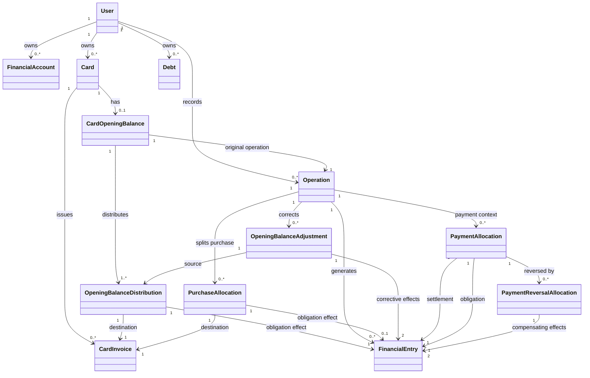
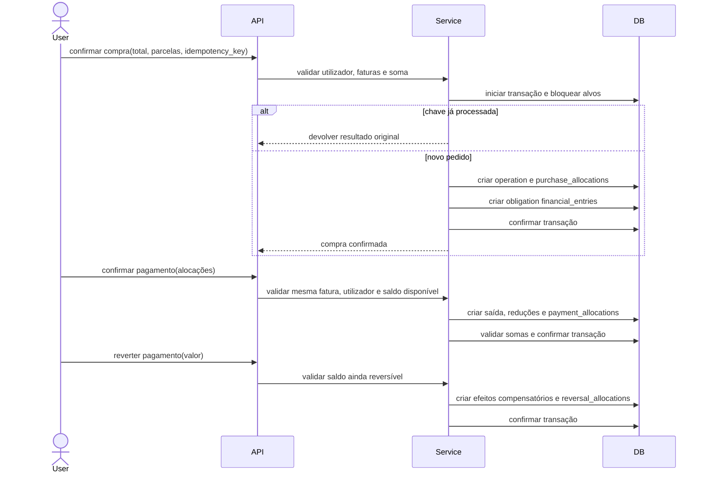
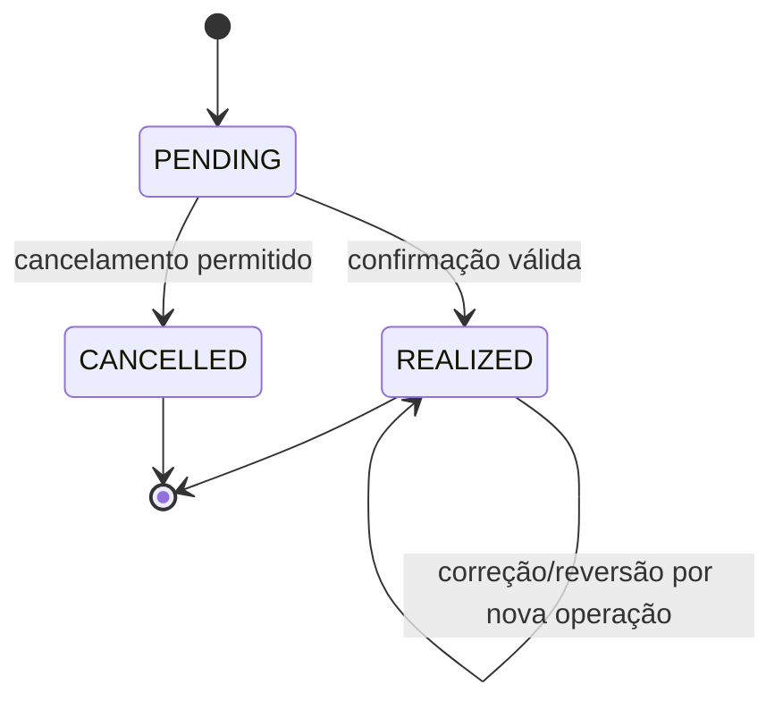
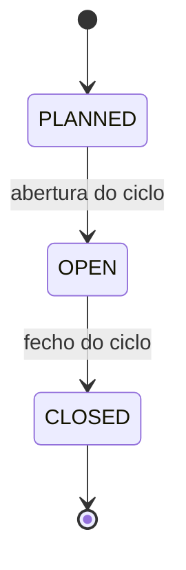

# 05 — Arquitetura e UML

**Estado:** stack, monorepo, ARC-001, modelo ER conceptual (ARC-002), UML complementar e modelo físico do núcleo financeiro estão aprovados. O modelo físico de módulos ainda não implementados permanece fora deste fecho.

## 1. Stack tecnológica aprovada
- **Backend:** Laravel 13 + PHP.
- **Base de dados:** MySQL 8.4 LTS.
- **Web:** React + TypeScript + Vite.
- **Mobile:** React Native + Expo + TypeScript para Android e iOS.
- **Comunicação:** API REST com JSON, comum aos dois clientes.
- **Organização:** monorepo único.

Estrutura lógica de referência:
```text
Orbe/
├── backend/
├── web/
├── mobile/
├── docs/
├── AGENTS.md
└── README.md
```

Cada aplicação mantém as suas próprias dependências, configuração e processo de execução. Não adotar Nx, Turborepo ou outra ferramenta de orquestração nesta fase sem necessidade demonstrada.

Web e mobile terão interfaces próprias. Tipos, validações e módulos partilháveis podem ser reutilizados quando adequado; componentes visuais não precisam de ser os mesmos.

## 2. Decisões arquiteturais já tomadas
- API Laravel comum para Web, Android e iOS.
- Monorepo para Backend, Web, Mobile e documentação.
- Preferência por monólito modular.
- Motor financeiro único.
- Separação conceptual entre operação (evento de negócio) e lançamentos (efeitos), relação 1:N.
- Estados e transições controlados pelas regras de domínio.
- Integridade e rastreabilidade financeira obrigatórias.
- **ARC-001 aprovado:** cada lançamento referencia exatamente um destino através de referências específicas com FKs próprias.

## 3. Modelo conceptual e ER

O modelo ER conceptual e a sua fundamentação estão em [07 — Modelo ER](07-modelo-er.md).

O documento detalha:
- Operação como evento de negócio e lançamento como efeito financeiro.
- Destinos específicos aprovados em ARC-001.
- Saldo inicial de cartão distribuído integralmente por faturas, com histórico, correções e reversões rastreáveis.
- Pagamentos multi-fatura com uma saída total e reduções por fatura.
- Cartões, faturas, dívidas, prestações, transferências, recorrências e conferências.
- A diferença entre os dados efetivos e os eventos usados em projeções.
- Como Dashboard, Movimentos, Rota Financeira e restantes páginas consultam o mesmo núcleo com objetivos e granularidades diferentes.

**Estado: ARC-002 aprovado.** O modelo ER conceptual incorpora saldo inicial integralmente distribuído, correções, reversões de pagamento e pagamentos multi-fatura. O diagrama continua a ser conceptual; não aprova o esquema físico nem autoriza migrations.

## 4. ARC-001 — Destino dos lançamentos financeiros

**Estado: aprovado. Alternativa A — referências específicas.**

### 4.1 Regra aprovada
Cada lançamento financeiro identifica exatamente um destino. O destino é representado por uma referência específica à entidade correspondente, com chave estrangeira própria.

Destinos considerados no modelo atual:
- Conta financeira: `account_id`
- Fatura: `invoice_id`
- Dívida/obrigação: `debt_id`

A estrutura final das colunas e os nomes físicos serão confirmados no modelo ER e no esquema físico. A decisão aprova o padrão de referências específicas, não todos os detalhes de implementação.

### 4.2 Integridade obrigatória
- Cada referência deve ter FK para a respetiva tabela.
- Exatamente uma referência de destino deve estar preenchida por lançamento.
- Implementar a regra de destino único com `CHECK` constraint no MySQL 8.4, acompanhada de testes.
- Aplicar índices necessários às FKs e consultas.
- Impedir referências cruzadas entre utilizadores; avaliar FKs compostas ou validação transacional no domínio.
- Preservar histórico financeiro; evitar eliminação em cascata de destinos com lançamentos associados.

### 4.3 Consequências para o modelo
Uma operação pode originar vários lançamentos. Cada lançamento representa um efeito financeiro e tem o seu próprio destino. Não colocar vários destinos no mesmo lançamento.

A alternativa de associação polimórfica (`destination_type + destination_id`) não será usada para os destinos centrais do motor financeiro, pois não oferece FK SQL direta para as diferentes tabelas. A superentidade genérica também não será introduzida nesta fase, por acrescentar complexidade sem benefício de domínio demonstrado.

A decisão poderá ser revista se surgir um novo requisito que justifique uma abstração diferente, mas não deve ser alterada apenas por conveniência do ORM.

### 4.4 Fundamentação técnica registada
A comparação considerou integridade referencial, complexidade do esquema, consultas, evolução e responsabilidade da aplicação. A alternativa A foi escolhida por manter a integridade próxima dos dados, tornar as relações explícitas e evitar uma abstração genérica prematura.

Fontes técnicas:
- [MySQL 8.4 — Foreign Key Constraints](https://dev.mysql.com/doc/refman/8.4/en/create-table-foreign-keys.html)
- [MySQL 8.4 — CHECK Constraints](https://dev.mysql.com/doc/refman/8.4/en/create-table-check-constraints.html)
- [Laravel 13 — Eloquent Polymorphic Relationships](https://laravel.com/docs/13.x/eloquent-relationships#polymorphic-relationships)

## 5. Arquitetura lógica proposta
- **Interface:** clientes Web (React) e mobile (React Native).
- **Aplicação:** API, autenticação, validação, autorização e casos de uso.
- **Domínio:** operações, lançamentos, contas, cartões, faturas, obrigações, recorrências e regras financeiras.
- **Infraestrutura:** MySQL, transações, bloqueios, scheduler, filas e consultas.

O domínio não deve depender da interface. Regras financeiras não devem ser reimplementadas separadamente nos clientes.

## 6. Consistência e concorrência — princípios consolidados
- Operações que geram vários lançamentos devem ser confirmadas numa única transação.
- Pagamento multi-fatura: uma saída total na conta, reduções por fatura e respetivas alocações são atómicas; cada par redução/obrigação pertence à mesma fatura.
- Compra parcelada: operação, alocações de compra e lançamentos de obrigação são confirmados em conjunto.
- Saldo inicial de cartão: operação original única por cartão, distribuição integral por faturas e lançamentos de obrigação confirmados em conjunto.
- Redistribuição e reversão: efeitos corretivos e relações de rastreabilidade são atómicos; não alteram lançamentos confirmados.
- Validações que abrangem várias linhas (somas, saldos restantes e alocações) exigem lógica de domínio/transação; não podem ser delegadas a um `CHECK` de linha.
- Bloquear o cartão e as linhas de obrigação/alvo numa ordem consistente antes de validar redistribuições e pagamentos concorrentes; recalcular os montantes disponíveis dentro da transação e tratar deadlocks com repetição segura.
- Usar chaves de idempotência/constraints de unicidade para impedir repetição de pagamentos, materialização de ocorrências e confirmação de compras.
- A unicidade de ciclo `OPEN` é protegida por índice `UNIQUE` sobre coluna gerada nullable e por bloqueio transacional da linha do cartão no MySQL 8.4.
- Tarefas assíncronas não podem quebrar a atomicidade dos efeitos financeiros imediatos.

## 7. Persistência e desempenho — proposta a validar
MySQL/InnoDB; índices baseados em consultas reais; análise de planos de execução; evitar N+1; paginação adequada; cache apenas de dados derivados e reconstruíveis. Não introduzir Redis, Elasticsearch ou microserviços sem necessidade demonstrada.

## 8. Precisão monetária — ARC-003

**Estado: aprovado para o núcleo financeiro.** Todos os valores monetários persistidos usam `DECIMAL(19,4)`. A aplicação usa aritmética decimal exata; `float` e `double` são proibidos em cálculos financeiros.

- Os quatro algarismos decimais são a escala canónica persistida.
- Valores com mais de quatro casas decimais são rejeitados; não há truncamento silencioso.
- Somatórios, saldos, alocações, pagamentos e reversões são calculados na escala canónica, sem arredondamento intermédio.
- Uma operação multi-linha só é confirmada quando as somas coincidem exatamente na escala canónica.
- Quando uma divisão necessária não for exata, o valor é distribuído em unidades de `0,0001`, atribuindo o resto por ordem determinística às primeiras parcelas; a soma final tem de coincidir exatamente com o total.
- O arredondamento para apresentação monetária é apenas visual, para duas casas, usando arredondamento half-up; não altera o valor persistido nem os cálculos.
- Conversões entre moeda, impostos e regras de escala de moedas não suportadas ficam fora deste contrato até existir decisão de produto.

## 9. UML a produzir e aprovar
1. ER: entidades, atributos essenciais, cardinalidades, chaves e constraints.
2. Domínio/classes: responsabilidades e relações financeiras.
3. Sequência: despesa, compra parcelada, abertura de ciclo, pagamento integral/parcial de fatura, plano vencido, saldo inicial de cartão, pagamento parcial de dívida, transferência, reversão/reembolso e recorrência.
4. Estados: transições de operações, ciclos de faturação, planos de pagamento e obrigações.
5. Modelo físico: tabelas, índices e integridade referencial, após aprovação conceptual.

### Sequência conceptual — compra parcelada
1. Confirmar uma única operação de compra.
2. Criar as alocações para os períodos de faturação identificados, incluindo períodos `PLANNED`.
3. Criar um lançamento de obrigação por alocação, com destino à respetiva fatura/período.
4. Não criar saída de conta bancária.
5. A abertura futura do ciclo altera apenas o estado operacional; não cria lançamentos.
6. A projeção de pagamentos futuros é calculada separadamente.

### Sequência conceptual — saldo inicial de cartão
1. Criar no máximo uma operação original de natureza `CARD_OPENING_BALANCE` por cartão, apenas quando o saldo inicial é positivo.
2. Exigir distribuição integral do valor por faturas/ciclos; a soma tem de coincidir exatamente com o valor declarado.
3. Criar um lançamento de obrigação por distribuição, sempre com destino `invoice_id`; não criar despesa, receita ou saída de conta.
4. Preservar as distribuições originais. Redistribuições posteriores são operações corretivas com redução na fatura de origem e aumento na fatura de destino.
5. A obrigação em aberto é reconstruída a partir dos lançamentos; as distribuições são rastreabilidade, não fonte paralela de saldo.

### Sequência conceptual — pagamento multi-fatura
1. Confirmar uma única operação de pagamento e criar uma saída total na conta.
2. Criar uma redução por cada fatura abrangida.
3. Criar `payment_allocations` entre cada redução e obrigações da mesma fatura.
4. Validar que a soma das reduções coincide com a saída e que nenhuma obrigação é liquidada acima do saldo disponível.
5. Confirmar saída, reduções e alocações na mesma transação.

### Sequência conceptual — reversão de pagamento
1. Criar uma operação de reversão ligada ao pagamento original.
2. Criar a entrada compensatória na conta e os aumentos compensatórios nas faturas afetadas.
3. Registar cada parcela revertida em `payment_reversal_allocations`, ligada à `payment_allocation` original.
4. Rejeitar reversões acumuladas superiores ao montante ainda não revertido.
5. Confirmar todos os efeitos e relações na mesma transação.

### Sequência conceptual — pagamento de fatura
1. Confirmar a operação de pagamento.
2. Criar o lançamento de saída com destino à conta.
3. Criar o lançamento de redução com destino à fatura.
4. Alocar a redução a um ou vários lançamentos de obrigação através de `payment_allocations`.
5. Validar limites e somas sob transação/bloqueio.
6. Confirmar tudo em conjunto; a operação não é uma despesa.

### Sequência conceptual — plano vencido
1. Antes da data, o plano reserva uma parcela identificada da obrigação e projeta a saída na data prevista.
2. Sem confirmação na data, o plano passa a vencido e deixa de ser saída futura nessa data passada.
3. A obrigação permanece vencida; a liquidação residual cobre apenas a parte não reservada.
4. Sem regra de débito/reagendamento automático aprovada, não criar uma nova data futura.

O ER conceptual está apresentado em [07 — Modelo ER](07-modelo-er.md). As vistas UML complementares e o modelo físico do núcleo financeiro estão fechados nas secções seguintes.

## 9.1 UML complementar de domínio



`Operation` identifica o evento, `FinancialEntry` representa o efeito e as entidades de allocation explicam relações entre efeitos. Nenhuma allocation é um lançamento ou altera saldo diretamente.

## 9.2 Sequência UML — compra parcelada, pagamento e reversão



## 9.3 Máquinas de estado do núcleo implementado



Para faturas, o ciclo operacional é independente da liquidação:



Uma fatura `CLOSED` pode manter obrigação em aberto. A transição de ciclo não cria lançamentos.

## 9.4 Modelo físico fechado — núcleo financeiro

O modelo físico aprovado para o núcleo implementado é InnoDB/MySQL e corresponde às migrations versionadas em `backend/database/migrations/`.

| Tabela | Papel | Constraints relevantes |
|---|---|---|
| `financial_accounts` | Destino de efeitos em contas | `user_id` e FK de utilizador |
| `cards` | Cartões de crédito | `credit_limit DECIMAL(19,4)`, dias entre 1 e 31 |
| `debts` | Obrigações/dívidas | `user_id` e FKs restritivas |
| `card_invoices` | Ciclos de faturação | `PLANNED/OPEN/CLOSED`, período válido, uma `OPEN` por cartão |
| `operations` | Eventos de negócio | `amount DECIMAL(19,4) > 0`, estado e idempotência |
| `financial_entries` | Efeitos financeiros | `amount DECIMAL(19,4) > 0`, exatamente um destino, efeito e estado válidos |
| `purchase_allocations` | Distribuição de compra | valor positivo, no máximo uma obrigação por allocation |
| `card_opening_balances` | Saldo inicial | valor positivo, relação única cartão/operação |
| `opening_balance_distributions` | Distribuição histórica | valor positivo, fatura e obrigação associadas |
| `opening_balance_adjustments` | Correções | `REDISTRIBUTION/REVERSAL`, dois efeitos rastreáveis |
| `payment_allocations` | Liquidação de obrigações | valor positivo e par redução/obrigação |
| `payment_reversal_allocations` | Reversão rastreável | valor positivo e efeitos compensatórios |

As regras que dependem de várias linhas — somas de alocações, saldo disponível, limites acumulados, coerência entre utilizador/fatura/operação e concorrência — permanecem validações transacionais dos serviços. Não são substituídas por `CHECK` de uma única linha.

O modelo físico fechado não afirma que entidades conceptuais ainda sem migration (`categories`, recorrências, planos, pernas de transferência, conferências e auditoria funcional) estejam implementadas. Essas extensões exigem migrations e contratos próprios antes de serem marcadas como concluídas.

## 10. Testes de arquitetura
Testar domínio sem interface, persistência/constraints, transações/concorrência, idempotência, fluxos financeiros completos e consistência entre consultas e saldos.

## 11. Decisões técnicas e de produto ainda pendentes
- Modelo físico final, cardinalidades, índices e constraints detalhadas.
- Representação monetária, escala e arredondamento (ARC-003).
- Autenticação e sessões (ARC-004).
- Alojamento, deploy e ambientes (ARC-006).
- Scheduler, filas e processamento assíncrono (ARC-007).
- Testes, CI/CD, backup e recuperação (ARC-008).
- Decisões de produto sobre débito/reagendamento automático de planos vencidos, apresentação de faturas antigas, compras no dia do fecho e crédito negativo de fatura.
- Fonte, janela, cálculo e apresentação das estimativas de despesas variáveis na Rota.
